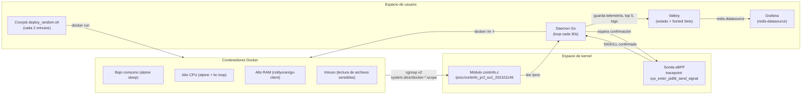

# Proyecto 2 – Sistema de Monitorización y Gestión Autónoma de Contenedores Docker

**Curso:** Sistemas Operativos 1
**Carné:** 202101149

Sistema que combina un módulo de kernel, una sonda eBPF, un daemon en Go y un dashboard de Grafana para observar en tiempo real el consumo de RAM y CPU de contenedores Docker y aplicar, de forma autónoma, una política de retención que mantiene siempre un número fijo de contenedores de bajo y alto consumo activos.

## Tabla de contenido

1. [Descripción general](#1-descripción-general)
2. [Arquitectura y componentes](#2-arquitectura-y-componentes)
3. [Estructura de carpetas](#3-estructura-de-carpetas)
4. [Prerrequisitos](#4-prerrequisitos)
5. [Instalación y ejecución paso a paso](#5-instalación-y-ejecución-paso-a-paso)
6. [Cómo detener todo limpiamente](#6-cómo-detener-todo-limpiamente)
7. [Decisiones de diseño para la defensa](#7-decisiones-de-diseño-para-la-defensa)
8. [Errores reales durante el desarrollo y su solución](#8-errores-reales-durante-el-desarrollo-y-su-solución)
9. [Problemas conocidos y limitaciones actuales](#9-problemas-conocidos-y-limitaciones-actuales)

## 1. Descripción general

El proyecto implementa un ciclo completo de observabilidad y gestión de contenedores a nivel de sistema operativo:

1. Un **módulo de kernel** expone telemetría de memoria RAM y una lista de procesos pertenecientes a contenedores Docker directamente en `/proc`.
2. Un **cronjob** despliega contenedores de prueba de forma periódica para generar carga variable (bajo consumo, alto consumo de CPU, alto consumo de RAM e intentos de "intrusión").
3. Un **daemon en Go** lee esa telemetría cada 30 segundos, decide qué contenedores deben sobrevivir según una política fija, y elimina el resto con `docker rm -f`.
4. Una **sonda eBPF** intercepta a nivel de kernel la syscall real que usa Docker/runc para matar procesos, confirmando que la eliminación fue efectiva antes de que el daemon la reporte como exitosa.
5. Un **dashboard de Grafana**, alimentado por Valkey, visualiza toda esta información en tiempo real.

Todo el ciclo corre sin intervención manual: el propio daemon levanta la infraestructura (Valkey y Grafana vía Docker Compose), carga el módulo de kernel, instala el cronjob del sistema y arranca la sonda eBPF.

## 2. Arquitectura y componentes



### 2.1 Módulo de kernel (`kernel-module/src/continfo.c`)

Expone en `/proc/continfo_pr2_so1_202101149` dos bloques de información:

- **Telemetría de RAM del sistema**: total, libre, buffers y dos cálculos de uso: bruto (`total - free`) y ajustado (`total - free - buffers`).
- **Lista de procesos de contenedores**: recorre `for_each_process` y, para cada tarea, obtiene su ruta de cgroup v2 con `cgroup_path(task_css_set(task)->dfl_cgrp, ...)`. Si la ruta contiene `docker-`, extrae el ID del contenedor y reporta PID, nombre del proceso, VSZ, RSS, `%RAM` (contra el total del sistema) y `%CPU` aproximado (`utime + stime` del proceso contra su tiempo de vida real, `ktime_get_boottime_ns() - start_boottime`).

<p align="center">
  
</p>

<p align="center"><em>Compilación con <code>make</code>, carga con <code>insmod</code> y lectura de <code>/proc/continfo_pr2_so1_202101149</code> mostrando la telemetría de RAM y la lista de procesos por contenedor.</em></p>

### 2.2 Cronjob de contenedores de prueba (`cronjob/deploy_random.sh`)

Instalado automáticamente por el daemon vía `crontab` para ejecutarse **cada 2 minutos**. En cada corrida despliega 5 contenedores eligiendo aleatoriamente entre cuatro perfiles de carga:

| Perfil | Imagen | Comportamiento |
|---|---|---|
| `low` | `alpine` | `sleep 240` (bajo consumo, idle) |
| `high_cpu` | `alpine` | Bucle infinito con `bc` (alto consumo de CPU) |
| `high_ram` | `roldyoran/go-client` | Alto consumo sostenido de RAM |
| `intruso` | `intruso:latest` (`docker-images/intruso`) | Lee repetidamente `/etc/passwd`, `/etc/shadow`, etc.; se clasifica como alto consumo por su nombre de cgroup |

### 2.3 Daemon orquestador (`daemon-go/`)

Escrito en Go, es el componente central. En su arranque (`cmd/main.go`):

1. Levanta Valkey y Grafana con `docker compose up -d` (con fallback a `docker-compose` si el plugin no está disponible).
2. Carga el módulo de kernel con `insmod` si `/proc/continfo_pr2_so1_202101149` todavía no existe.
3. Arranca la sonda eBPF (`ebpfprobe.StartPidfdProbe`).
4. Instala el cronjob de despliegue de contenedores de prueba.
5. Entra en un bucle infinito cada 30 segundos que:
   - Lee y parsea `/proc/continfo_pr2_so1_202101149` (`internal/procparser`).
   - Agrupa los procesos por ID de contenedor, sumando RSS/VSZ/`%RAM`/`%CPU` (`internal/manager`, ver [decisión de diseño](#agrupación-por-id-de-contenedor-cgroup)).
   - Evalúa la política de retención y elimina los contenedores excedentes.
   - Guarda telemetría, logs de decisión y rankings Top 5 en Valkey (`internal/valkey`).

**Política de gestión** (`internal/manager/container_manager.go`):

- Los contenedores cuyo nombre o cgroup coincide con `valkey`, `valkey_db`, `grafana` o `grafana_dashboard` están **protegidos** y nunca se evalúan para eliminación.
- Un contenedor se clasifica como **alto consumo** si su nombre/cgroup contiene `intruso` o `go-client`, o si supera `%CPU > 5.0` o `RSS > 10000 KB`; en caso contrario es **bajo consumo**.
- Se ordena cada categoría de forma descendente por RSS (y luego `%CPU`, luego VSZ) y se conservan exactamente **3 contenedores de bajo consumo** y **2 de alto consumo**; el resto se elimina con `sudo docker rm -f <id>`, empezando por los más pesados del excedente.
- Cada eliminación intenta confirmarse con la sonda eBPF antes de registrarse en el log de decisiones (`DecisionLog.EBPFConfirmed`).

### 2.4 Sonda eBPF (`daemon-go/internal/ebpfprobe/`)

Construida con `cilium/ebpf` y generada con `bpf2go`. Se engancha a un tracepoint del kernel para detectar, en tiempo real, cuándo un proceso realmente recibe una señal de terminación. Es el componente que más iteraciones de investigación tomó del proyecto (ver [sección 8](#8-errores-reales-durante-el-desarrollo-y-su-solución) y [sección 7](#por-qué-pidfd_send_signal-y-no-sys_kill) para el detalle completo), y actualmente está **funcional de punta a punta**: cada `docker rm -f` ejecutado por el daemon queda confirmado a nivel de kernel dentro de la ventana de espera.

- `probe_pidfd.c` / `loader_pidfd.go`: versión **usada en producción** por el daemon. Se adjunta a `tracepoint/syscalls/sys_enter_pidfd_send_signal`, filtra por `sig == SIGKILL (9)` (descartando cualquier otra señal, incluida la señal `0` de comprobación de vida) y publica el evento en un `BPF_MAP_TYPE_RINGBUF`. El daemon espera hasta 3 segundos (`ebpfConfirmTimeout`) una confirmación antes de continuar.
- `probe.c` / `loader.go`: versión **de investigación**, enganchada a `sys_enter_kill`. Se conserva en el repositorio como evidencia del proceso de descubrimiento explicado en la sección de decisiones de diseño; ya no la usa el daemon.
- `cmd/ebpftest` y `cmd/ebpftestpidfd`: binarios independientes para probar cada sonda de forma aislada (`go run ./cmd/ebpftestpidfd`), útiles para depuración sin levantar todo el sistema.

<p align="center">
  
</p>

<p align="center"><em>Evidencia real de la fase de investigación: la sonda basada en <code>sys_enter_kill</code> sí capturaba eventos, pero siempre con <code>signal=0</code>. Ese hallazgo (junto con <code>strace</code> sobre <code>docker rm -f</code>) llevó a migrar a <code>pidfd_send_signal</code>. Ver la sección de [decisiones de diseño](#por-qué-pidfd_send_signal-y-no-sys_kill).</em></p>

### 2.5 Dashboard de Grafana

Grafana corre en un contenedor (`docker-compose.yml`, imagen `grafana/grafana:11.2.0`) con el plugin `redis-datasource` instalado vía `GF_INSTALL_PLUGINS` (también existe un `Dockerfile` alternativo que lo instala en una ruta de plugins separada para no perder la instalación con los volúmenes). El datasource `Valkey` (`provisioning/datasources/valkey.yml`) apunta a `valkey-db:6379` y el dashboard `PANEL DE CONTENEDORES POR 202101149` (`provisioning/dashboards/contenedor_dashboard.json`) se autoprovisiona con los siguientes paneles:

| Panel | Tipo | Fuente en Valkey |
|---|---|---|
| TOTAL RAM | Stat | `latest_telemetry` (clave `GET`) |
| FREE RAM | Stat | `latest_telemetry` |
| TOTAL CONTENEDORES ELIMINADOS | Stat | `decision_logs` (lista) |
| GRAFICA DE USO DE RAM EN EL TIEMPO | Time series | `telemetry_history` (lista, `LRANGE`) |
| TOP 5 +RAM | Bar gauge | `top_ram` (Sorted Set, `ZREVRANGE ... WITHSCORES`) |
| TOP 5 +CPU | Bar gauge | `top_cpu` (Sorted Set, `ZREVRANGE ... WITHSCORES`) |
| eBPF EVENT COUNTER | Stat | `ebpf_kill_events_total` (contador) |

<p align="center">
  
</p>

<p align="center"><em>Dashboard funcionando con datos reales: RAM total/libre, evolución en el tiempo, Top 5 por RAM y CPU, y contador de eventos eBPF confirmados.</em></p>

<p align="center">
  
</p>

<p align="center"><em>El panel Top 5 +RAM consulta directamente el Sorted Set <code>top_ram</code> con <code>ZREVRANGE top_ram 0 4 WITHSCORES</code>, donde el score es el RSS en KB y el miembro identifica contenedor y comando.</em></p>

<p align="center">
  
</p>

<p align="center"><em>Configuración del datasource <code>valkey.yml</code> y verificación manual de los logs de decisión del daemon con <code>valkey-cli LRANGE decision_logs 0 -1</code>, mostrando el JSON de cada acción <code>KILL</code> tomada.</em></p>

## 3. Estructura de carpetas

```
Proyecto2/
├── kernel-module/
│   └── src/
│       ├── continfo.c        # Módulo de kernel (telemetría RAM + procesos por contenedor)
│       ├── modulo_ejemplo.c  # Plantilla de ejemplo del curso (no forma parte del sistema)
│       ├── Makefile
│       └── test_module.sh    # Script de prueba manual del módulo
├── cronjob/
│   └── deploy_random.sh      # Despliegue aleatorio de contenedores de prueba
├── docker-images/
│   └── intruso/               # Imagen del contenedor "intruso" (Dockerfile + script)
├── daemon-go/
│   ├── cmd/
│   │   ├── main.go            # Entry point del daemon orquestador
│   │   ├── ebpftest/          # Binario de prueba de la sonda sys_enter_kill (legado)
│   │   └── ebpftestpidfd/     # Binario de prueba de la sonda pidfd_send_signal (actual)
│   └── internal/
│       ├── procparser/        # Parser de /proc/continfo_pr2_so1_202101149
│       ├── manager/           # Política de retención y eliminación de contenedores
│       ├── valkey/            # Cliente de persistencia en Valkey
│       └── ebpfprobe/         # Fuentes eBPF (.c) y bindings generados por bpf2go
├── provisioning/
│   ├── datasources/valkey.yml
│   └── dashboards/            # Dashboard JSON + provider
├── grafana-data/               # Datos persistentes de Grafana (volumen)
├── valkey-data/                 # Datos persistentes de Valkey (volumen, dump.rdb)
├── docker-compose.yml          # Servicios Valkey + Grafana
├── Dockerfile                  # Build alternativo de Grafana con el plugin preinstalado
├── docs/                        # Reservado para documentación adicional (vacío)
├── ebpf/                        # Carpeta placeholder original del scaffold del proyecto;
│                                 # el código eBPF real vive en daemon-go/internal/ebpfprobe
└── Images/                      # Capturas de pantalla usadas en este README
```

## 4. Prerrequisitos

- **Sistema operativo**: Ubuntu (o distribución Linux equivalente) con soporte para compilar módulos de kernel out-of-tree y para eBPF. Se necesita el kernel headers del kernel en ejecución:
  ```bash
  sudo apt update
  sudo apt install -y linux-headers-$(uname -r) build-essential
  ```
- **Docker** y **Docker Compose** (plugin `docker compose` o binario `docker-compose`).
- **Go 1.23 o superior**.
- **Herramientas eBPF**: `clang`, `llvm` y `libbpf-dev` (solo necesarias si se va a regenerar el bytecode eBPF con `bpf2go`; los archivos `*_bpfel.go` ya generados están versionados):
  ```bash
  sudo apt install -y clang llvm libbpf-dev
  ```
- Kernel con `CONFIG_DEBUG_INFO_BTF` habilitado es recomendable (no obligatorio) para que `bpf2go`/libbpf puedan resolver tipos automáticamente; en su ausencia el sistema sigue funcionando con el `vmlinux.h` incluido en el repositorio.
- Privilegios de **root** (o `sudo` sin contraseña para el usuario del daemon): son necesarios para `insmod`, adjuntar tracepoints eBPF, ejecutar `docker rm -f` y modificar el `crontab` del sistema.

## 5. Instalación y ejecución paso a paso

### 5.1 Clonar y ubicarse en el proyecto

```bash
cd Proyecto2
```

### 5.2 Compilar el módulo de kernel

```bash
cd kernel-module/src
make
cd ../..
```

Esto genera `kernel-module/src/continfo.ko`. No es necesario cargarlo manualmente: el daemon lo hace por su cuenta en el arranque si detecta que `/proc/continfo_pr2_so1_202101149` no existe. Si se prefiere cargarlo a mano para probarlo de forma aislada:

```bash
sudo insmod kernel-module/src/continfo.ko
cat /proc/continfo_pr2_so1_202101149
```

### 5.3 Construir la imagen del contenedor "intruso" (opcional, usada por el cronjob)

```bash
cd docker-images/intruso
docker build -t intruso:latest .
cd ../..
```

### 5.4 (Opcional) Regenerar los bindings de eBPF

Solo necesario si se modifica `probe_pidfd.c` o `probe.c`. Requiere `clang`/`llvm`/`libbpf-dev` instalados:

```bash
cd daemon-go/internal/ebpfprobe
go generate ./...
cd ../../..
```

### 5.5 Compilar el daemon en Go

```bash
cd daemon-go
go build -o daemon-go ./cmd
cd ..
```

### 5.6 Ejecutar el sistema completo

El daemon debe correr con privilegios elevados porque carga el módulo de kernel, adjunta la sonda eBPF, ejecuta `docker rm -f` y administra el `crontab` del sistema:

```bash
sudo ./daemon-go/daemon-go
```

Al arrancar, en orden, el daemon:

1. Ejecuta `docker compose up -d` para levantar Valkey (`valkey-db`, puerto `6379`) y Grafana (`grafana-valkey`, puerto `3001`).
2. Carga `continfo.ko` si aún no está cargado.
3. Inicia la sonda eBPF sobre `pidfd_send_signal`.
4. Instala en el `crontab` del usuario la ejecución de `cronjob/deploy_random.sh` cada 2 minutos.
5. Entra al bucle de 30 segundos de lectura, decisión y persistencia en Valkey.

### 5.7 Verificar que todo esté funcionando

```bash
# Telemetría cruda del kernel
cat /proc/continfo_pr2_so1_202101149

# Contenedores activos gestionados por el daemon
docker ps

# Estado de Valkey y Grafana
docker compose ps

# Datos crudos en Valkey
docker exec -it valkey-db valkey-cli GET latest_telemetry
docker exec -it valkey-db valkey-cli LRANGE decision_logs 0 -1
```

Luego abrir el dashboard en el navegador:

```
http://localhost:3001
```

Usuario: `admin` / Contraseña: `admin` (definidos en `docker-compose.yml`, se recomienda cambiarlos si el entorno no es efímero).

## 6. Cómo detener todo limpiamente

1. **Detener el daemon**: enviar `Ctrl+C` (SIGINT) o `SIGTERM` al proceso. El propio daemon captura la señal y ejecuta `crontab -r` para eliminar el cronjob del sistema antes de salir; también libera la sonda eBPF (`pidfdProbe.Close()`).
   ```bash
   sudo kill -TERM <PID_del_daemon>
   ```
2. **Descargar el módulo de kernel**:
   ```bash
   sudo rmmod continfo
   ```
3. **Bajar Valkey y Grafana** (desde la raíz del proyecto, donde está `docker-compose.yml`):
   ```bash
   docker compose down
   ```
4. **Eliminar los contenedores de prueba residuales** (los que el cronjob haya creado y que el daemon no haya limpiado si se detuvo antes de un ciclo):
   ```bash
   docker ps -a --filter "name=c_low" --filter "name=c_hcpu" --filter "name=c_hram" --filter "name=c_intruso" -q | xargs -r docker rm -f
   ```
5. **Verificar que el cronjob quedó eliminado**:
   ```bash
   crontab -l
   ```
   Si por algún motivo el daemon no llegó a ejecutar la limpieza (por ejemplo, un `kill -9`), remover manualmente con `crontab -r` o editando con `crontab -e`.

## 7. Decisiones de diseño para la defensa

### Por qué `pidfd_send_signal` y no `sys_kill`

Este fue el hallazgo que más tiempo de investigación tomó del proyecto, y se hizo por descarte, en capas, hasta llegar a evidencia irrefutable:

1. **Capa 1 – `sys_enter_kill`** (`probe.c`). La sonda sí capturaba eventos constantemente, pero **siempre con `signal=0`**, tal como se ve en la captura de la sección [2.4 Sonda eBPF](#24-sonda-ebpf-daemon-gointernalebpfprobe). Señal `0` en `kill()` es el idioma estándar de Unix para "verificar si el proceso existe" (`kill(pid, 0)`), usado constantemente por `systemd` y otros procesos en segundo plano para chequear procesos vivos; no tiene nada que ver con terminar un contenedor. Al ejecutar `docker rm -f` de forma controlada mientras la sonda corría, **no aparecía ningún evento nuevo atribuible a esa eliminación**, solo el ruido de fondo de siempre.
2. **Capa 2 – `sys_enter_tgkill`**. Se probó la hipótesis de que Docker/runc enviaran la señal al hilo específico (`tgkill` en vez de `kill`). Mismo resultado: la sonda solo capturaba ruido de fondo, en este caso principalmente de `systemd-udevd` reciclando sus workers internos con señales de tiempo real (`real-time signals`), y ningún evento correlacionado con `docker rm -f`.
3. **Capa 3 – `sys_enter_pidfd_send_signal` vía `bpftrace`**. Como validación rápida antes de escribir el programa eBPF completo, se intentó una prueba exploratoria con `bpftrace` sobre este tracepoint. Falló por un problema de resolución de tipos: el campo de `siginfo_t` del tracepoint no se podía resolver correctamente contra el BTF disponible, así que `bpftrace` no lograba desambiguar la estructura.
4. **Confirmación definitiva con `strace -f`**. Se hizo `strace -f` sobre el proceso `containerd-shim` correspondiente al contenedor (siguiendo también los procesos hijos que lanza, como `runc`) mientras se ejecutaba `docker rm -f` desde otra terminal. Ahí apareció, sin ambigüedad, la syscall real: `pidfd_send_signal(pidfd, SIGKILL, NULL, 0)`, invocada por `runc`.

Docker/runc usan `pidfd_send_signal` en vez de `kill(2)` porque opera sobre un *file descriptor* que referencia al proceso (`pidfd`) en lugar de sobre su PID numérico, evitando condiciones de carrera por reciclaje de PID entre el momento en que se localiza el proceso y el momento en que se le envía la señal. Por eso el módulo eBPF de producción se engancha a `sys_enter_pidfd_send_signal` y filtra por `sig == SIGKILL`, descartando además cualquier evento con `sig == 0` (el mismo ruido de comprobación de vida detectado en la capa 1).

Esta migración es también la explicación de por qué el repositorio conserva la sonda de investigación (`probe.c`, `sys_enter_kill`) junto a la de producción (`probe_pidfd.c`): la primera documenta el proceso de descubrimiento, la segunda es la que efectivamente usa el daemon.

### Confirmación por correlación temporal, no por resolución de PID

El enunciado permite que los campos de PID en el evento eBPF sean opcionales, y aquí se aprovechó esa libertad de forma deliberada. `pidfd_send_signal` recibe un **file descriptor**, no un PID: para traducir ese `pidfd` al PID real del proceso señalado desde un programa eBPF habría que navegar estructuras internas del kernel (la tabla de file descriptors del proceso llamante y la `struct pid` asociada), algo que agrega complejidad y fragilidad entre versiones de kernel sin aportar valor real al objetivo del proyecto.

En su lugar, la confirmación se diseñó por **correlación temporal**: justo después de ejecutar su propio `docker rm -f`, el daemon abre una ventana corta (`ebpfConfirmTimeout = 3 segundos`, ver `WaitForKillConfirmation` en `internal/ebpfprobe/loader_pidfd.go`) y considera confirmada la eliminación si llega **cualquier** evento `SIGKILL` vía `pidfd_send_signal` dentro de esa ventana. Es una confirmación *best-effort* (no verifica que el PID señalado sea exactamente el del contenedor eliminado), pero es suficiente para el objetivo del proyecto: demostrar, con evidencia de kernel, que una terminación real ocurrió en el sistema en el momento esperado, y no solo que el comando `docker rm -f` retornó código de salida `0`.

### Agrupación por ID de contenedor (cgroup)

El módulo de kernel reporta **procesos**, no contenedores: un mismo contenedor puede tener varios procesos con el mismo ID de cgroup. Esto no era una hipótesis teórica: se detectó como **bug real** durante el desarrollo (detallado en la [sección 8](#bug-de-contenedores-duplicados-en-la-eliminación)), cuando el daemon intentaba eliminar dos veces el mismo contenedor de Grafana en una sola iteración porque su binario principal y el plugin `redis-datasource` aparecían como dos procesos independientes con el mismo `container_id` en `/proc`.

Por eso `procparser.ParseProcFile` agrupa las líneas por `container_id` (extraído por el propio módulo de kernel desde `system.slice/docker-<id>.scope`) en un mapa, **sumando** RSS, VSZ, `%RAM` y `%CPU` de todos los procesos de un mismo contenedor, y **concatenando** sus nombres de comando (por ejemplo `grafana+redis-datasource`) antes de pasarle esa información al `manager`. Esto garantiza que la política de retención evalúe el consumo agregado real de cada contenedor, no de cada proceso aislado, y que el filtro de contenedores protegidos pueda seguir reconociendo a Grafana aunque su primer proceso leído en esa iteración no se llame literalmente `grafana`.

### Limitación conocida: RAM bruto vs. RAM ajustada

El módulo expone dos cálculos de uso de memoria a partir de `struct sysinfo` (poblada con `si_meminfo()`):

- **Bruto**: `total - free`.
- **Ajustado**: `total - free - bufferram` (el campo `bufferram` ya viene disponible directamente en `struct sysinfo`, sin cálculos adicionales).

El cálculo bruto sobreestima el uso real porque cuenta como "usada" memoria que Linux reserva para caché de disco y buffers, aunque el kernel puede reclamarla de forma instantánea si una aplicación la necesita. El cálculo ajustado se acerca más a la realidad al descontar los buffers, pero **sigue sin equivaler exactamente a `MemAvailable`** (el campo que expone `/proc/meminfo` y en el que se basan herramientas como `free -m` para estimar memoria "realmente disponible"), porque no descuenta la totalidad de la *page cache* reclamable: ese dato no está expuesto por `si_meminfo()`, sino que requeriría leer contadores internos adicionales del kernel (como `NR_FILE_PAGES` o el propio cálculo interno que usa `si_mem_available()`). Se documenta como limitación conocida y no como bug: corregirlo del todo implicaría depender de símbolos internos del kernel no exportados de forma estable para módulos out-of-tree.

### Invariantes de la política de retención (3 bajo consumo / 2 alto consumo)

Se fijó una política simple y determinista en lugar de umbrales dinámicos para que el comportamiento del sistema sea predecible y fácil de verificar en la defensa: siempre 3 contenedores de bajo consumo y 2 de alto consumo activos, eliminando primero los más pesados del excedente en cada categoría (ordenamiento descendente por RSS, luego `%CPU`, luego VSZ). Valkey y Grafana están explícitamente protegidos por nombre/cgroup (`ProtectedNames`) para que nunca compitan por esos cupos, ya que son infraestructura del propio sistema y no carga de prueba.

### Uso de Sorted Sets de Valkey para los rankings Top 5

Los paneles "TOP 5 +RAM" y "TOP 5 +CPU" usan `ZADD`/`ZREVRANGE ... WITHSCORES` sobre Sorted Sets (`top_ram`, `top_cpu`) en lugar de, por ejemplo, ordenar en el propio dashboard. Esto delega el ordenamiento a Valkey (estructura de datos nativa para rankings, O(log n) por inserción) y simplifica el panel de Grafana a una sola consulta sin lógica adicional de transformación.

## 8. Errores reales durante el desarrollo y su solución

Esta sección documenta bugs concretos que aparecieron durante el desarrollo, ya resueltos en el código actual, junto con el razonamiento de depuración que llevó a cada fix. Se incluye porque explica el "por qué" detrás de varias decisiones de la sección anterior.

### Bug de contenedores duplicados en la eliminación

**Síntoma**: el daemon intentaba eliminar el mismo contenedor dos veces en una misma iteración del bucle de 30 segundos.

**Causa**: el módulo de kernel genera una línea de `/proc` por cada **proceso**, y un contenedor con múltiples procesos (por ejemplo Grafana, que corre el binario `grafana` más el plugin `redis-datasource` como procesos separados dentro del mismo contenedor) generaba múltiples entradas con el mismo `container_id`. El parser en Go las trataba como contenedores independientes, así que ambas "copias" del mismo contenedor podían terminar en la lista de candidatos a eliminar.

**Fix**: agrupar por `container_id` en un mapa durante el parseo (`procparser.ParseProcFile`), sumando `RSSKB`, `VSZKB`, `RAMPerc` y `CPUPerc` de todas las líneas que compartan el mismo ID, antes de convertir el mapa a la lista final de contenedores que consume el `manager`. Ver también la decisión de diseño [Agrupación por ID de contenedor (cgroup)](#agrupación-por-id-de-contenedor-cgroup).

### Grafana detectado como no protegido y candidato a eliminación

**Síntoma**: consecuencia directa del bug anterior. Tras agrupar por ID, en algunas iteraciones Grafana dejaba de ser reconocido como contenedor protegido.

**Causa**: al agrupar por `container_id`, el campo `Command` se quedaba únicamente con el nombre del primer proceso leído en esa iteración, que en algunos casos era `redis-datasource` en vez de `grafana` (el orden en que el kernel recorre `for_each_process` no está garantizado). El filtro de contenedores protegidos (`isProtected`, que busca la palabra `grafana` dentro de `Command`) fallaba en esas iteraciones.

**Fix**: en vez de quedarse con el primer nombre de proceso, concatenar los nombres de todos los procesos agrupados bajo un mismo ID (por ejemplo `grafana+redis-datasource`), de modo que el filtro de protegidos siempre encuentre la subcadena `grafana` sin importar el orden de lectura de `/proc`.

### Error `Invalid module format` al cargar el módulo de kernel

**Síntoma**: `sudo insmod continfo.ko` fallaba con `insmod: ERROR: could not insert module continfo.ko: Invalid module format`.

**Causa**: Ubuntu aplica actualizaciones de kernel en segundo plano (`unattended-upgrades`) sin reiniciar el equipo, así que el kernel corriendo en memoria (`uname -r`) queda desincronizado de la versión más reciente instalada en disco. Un módulo compilado contra los headers de una versión no carga en un kernel de otra versión, porque el `vermagic` embebido en el `.ko` no coincide con el del kernel activo.

**Fix**: recompilar siempre el módulo (`make clean && make`) contra el kernel efectivamente en ejecución antes de cada sesión de trabajo o de cada demo; como medida adicional durante el desarrollo, se recomienda deshabilitar temporalmente las actualizaciones automáticas de kernel (`unattended-upgrades`) para evitar esta desincronización mientras dura el proyecto.

### Conflictos de puerto al levantar Valkey y Grafana (`address already in use`)

**Síntoma**: `docker compose up -d` fallaba (o los contenedores quedaban en estado de reinicio) al intentar publicar los puertos `6379` y `3000`.

**Causa**: existían instalaciones nativas de Redis y Grafana directamente en el sistema operativo, provenientes de prácticas anteriores del curso, ocupando esos mismos puertos por fuera de Docker.

**Fix**: identificar los procesos nativos que ocupaban los puertos con `sudo lsof -i :6379` y `sudo lsof -i :3000`, y detener/deshabilitar los servicios `systemd` correspondientes (`sudo systemctl stop redis-server grafana-server` y `sudo systemctl disable redis-server grafana-server`) antes de levantar el stack con Docker Compose.

### La sonda eBPF no capturaba eventos al eliminar contenedores reales

**Síntoma**: la sonda funcionaba correctamente contra pruebas manuales (por ejemplo `kill -0 <pid>`), pero no generaba ningún evento correlacionado con un `docker rm -f` real.

**Causa y resolución**: este fue el error más profundo del proyecto, investigado en varias capas (`sys_enter_kill` → `sys_enter_tgkill` → `sys_enter_pidfd_send_signal` con `bpftrace` → `strace -f` sobre `containerd-shim`) hasta encontrar la syscall real (`pidfd_send_signal`). El detalle completo de esta investigación está en la sección [Por qué `pidfd_send_signal` y no `sys_kill`](#por-qué-pidfd_send_signal-y-no-sys_kill), ya que es, a la vez, un error enfrentado durante el desarrollo y la decisión de diseño resultante.

### Ruido de señal `0` en la sonda de `kill`

**Síntoma**: la sonda original sobre `sys_enter_kill` capturaba cientos de eventos por minuto, todos con `signal=0`.

**Causa**: `kill(pid, 0)` es el idiomatismo estándar de Unix para comprobar si un proceso sigue vivo (sin enviarle señal real), usado constantemente por `systemd` y otros servicios de monitoreo internos del sistema; no tiene relación con terminar procesos.

**Fix**: filtrar dentro del propio programa eBPF, descartando cualquier evento donde la señal capturada sea `0` antes de escribirlo al ring buffer (`if (ctx->sig == 0) return 0;`), en vez de dejar que ese filtrado ocurra en espacio de usuario. El mismo criterio de filtrado (por señal, ahora exigiendo específicamente `SIGKILL`) se mantiene en la sonda de producción `probe_pidfd.c`.

### Error de compilación `C source files not allowed when not using cgo`

**Síntoma**: al compilar el proyecto con `go build ./...`, el compilador de Go fallaba señalando los archivos `.c` de `internal/ebpfprobe` con el error `C source files not allowed when not using cgo`.

**Causa**: Go interpreta cualquier archivo `.c` dentro de un paquete como parte de una compilación cgo si no se le indica explícitamente lo contrario, aunque ese `.c` no esté pensado para compilarse con el toolchain de Go sino solo como fuente de entrada para `bpf2go`.

**Fix**: agregar `//go:build ignore` como primera línea de cada archivo `.c` usado únicamente como fuente para `bpf2go` (`probe.c` y `probe_pidfd.c`), de modo que el compilador de Go los excluya por completo de la compilación normal y solo `bpf2go` los procese durante `go generate`.

### Paneles de Grafana mostrando "No data" con datos ya confirmados en Valkey

**Síntoma**: se verificaba con `valkey-cli` que claves como `telemetry_history` o `top_ram` sí tenían datos, pero el panel correspondiente en Grafana mostraba `No data` o errores de tipo.

**Causa**: la versión del plugin `redis-datasource` usada en este proyecto no expone todos los comandos de Redis/Valkey (como `LRANGE` o `ZREVRANGE`) en su selector estructurado de tipo `Redis`; al intentar forzar el comando en ese modo estructurado, además, el tipo de rango (`Score range`, pensado para Sorted Sets) no aplica a una lista y Valkey responde con errores de tipo como `ERR value is not an integer or out of range`.

**Fix**: cambiar el tipo de consulta del panel de `Redis` (estructurado) a **`Command-line`**, y escribir el comando completo como texto crudo (por ejemplo `ZREVRANGE top_ram 0 4 WITHSCORES` o `LRANGE telemetry_history 0 -1`), tal como se ve en la captura del panel Top 5 +RAM de la sección [2.5](#25-dashboard-de-grafana).

<p align="center">
  
</p>

<p align="center"><em>Antes del fix: el selector estructurado de tipo <code>Redis</code> no reconoce <code>lrange</code> ("No options found") y, forzado con <code>Range Query: Score range</code> sobre una lista, produce <code>ERR value is not an integer or out of range</code>.</em></p>

## 9. Problemas conocidos y limitaciones actuales

### "No data" en paneles recién creados o justo después de reiniciar el stack

**Síntoma**: al editar o crear un panel apuntando a claves como `latest_telemetry` o `ebpf_kill_events_total`, Grafana muestra `No data` aunque el sistema esté corriendo.

**Causa**: esas claves las escribe el daemon una vez por cada iteración de 30 segundos; si Valkey se reinició o el daemon recién arrancó, la clave todavía no existe.

**Solución**: esperar al menos un ciclo completo (30 segundos) después de que el daemon imprima `--- Iteracion de Telemetria y Gestion ---` en su log, o verificar manualmente con `valkey-cli GET latest_telemetry` antes de depurar el panel.

<p align="center">
  
</p>

### El contador persistente `ebpf_kill_events_total` puede quedar desincronizado del total real

**Observación de código**: la confirmación en tiempo real de la sonda eBPF (`WaitForKillConfirmation`, ver [sección 7](#confirmación-por-correlación-temporal-no-por-resolución-de-pid)) funciona correctamente y es la que marca `EBPFConfirmed` en cada `DecisionLog`; ese mecanismo ya es funcional de punta a punta. Lo que queda pendiente es la conexión de ese resultado con el contador **persistente** en Valkey: el método `ValkeyClient.IncrementEBPFEventCount` existe en `internal/valkey/client.go`, pero todavía no se invoca automáticamente tras cada `confirmed == true` en `stopAndRemoveContainer`.

**Impacto**: el valor del panel "eBPF EVENT COUNTER" no necesariamente refleja el conteo acumulado de eliminaciones confirmadas si esa clave no fue incrementada en el punto correcto del flujo; es independiente del correcto funcionamiento de la confirmación en sí.

**Solución recomendada**: en `stopAndRemoveContainer` (`internal/manager/container_manager.go`), tras un `confirmed == true`, llamar a `vClient.IncrementEBPFEventCount(ctx)` (requiere pasar el cliente de Valkey al manager o exponer un callback), de modo que el contador crezca exactamente una vez por cada eliminación confirmada a nivel de kernel.

<p align="center">
  
  
</p>

<p align="center"><em>El panel "eBPF EVENT COUNTER" consultando <code>ebpf_kill_events_total</code> durante una de las sesiones de depuración de esta desconexión puntual entre confirmación y contador persistente.</em></p>

### Ruta de proyecto por defecto embebida en el binario

**Observación de código**: `getRootDir()` en `cmd/main.go` intenta ubicar dinámicamente la raíz del proyecto a partir de la ruta del ejecutable, pero si esa heurística falla cae a una ruta absoluta fija (`/home/mariano/202101149_LAB_SO1_1S2026/Proyecto2`).

**Impacto**: si el binario se copia a otra máquina o a otro usuario sin conservar la misma jerarquía de carpetas relativa a `cmd/` o `daemon-go/`, el daemon podría no encontrar `docker-compose.yml` ni `continfo.ko`.

**Solución**: ejecutar siempre el binario `daemon-go` desde `daemon-go/` (o `daemon-go/cmd/`) dentro de una copia completa del repositorio, que es el caso soportado por la heurística; alternativamente, parametrizar la raíz vía variable de entorno o flag si el proyecto se despliega en otra ruta.

### Advertencia `Skipping BTF generation ... due to unavailability of vmlinux`

**Síntoma**: al compilar el módulo de kernel con `make`, aparece la advertencia `BTF [M] ... Skipping BTF generation for continfo.ko due to unavailability of vmlinux`.

**Causa**: el kernel en ejecución no tiene disponible `/sys/kernel/btf/vmlinux` (información BTF del propio kernel), típicamente porque no se compiló con `CONFIG_DEBUG_INFO_BTF=y`.

**Impacto**: ninguno para este proyecto; el módulo `continfo.ko` no depende de BTF (usa la API `/proc` clásica). Es una advertencia informativa del proceso de build, no un error. El `vmlinux.h` usado por la sonda eBPF ya está generado y versionado en `internal/ebpfprobe/`, por lo que la sonda funciona independientemente de esta advertencia.

### Truncamiento de la ruta de cgroup en `continfo.c`

**Observación de código**: `cgroup_path_buf` se declara como `char[256]`. En jerarquías de cgroup muy profundas o con nombres de contenedor inusualmente largos, `cgroup_path()` podría truncar la ruta. En la práctica, con las rutas estándar de Docker (`/system.slice/docker-<64 hex>.scope`) el buffer es más que suficiente, pero se documenta como límite conocido del parseo si en el futuro se usa con otro runtime de contenedores con rutas de cgroup más largas.
