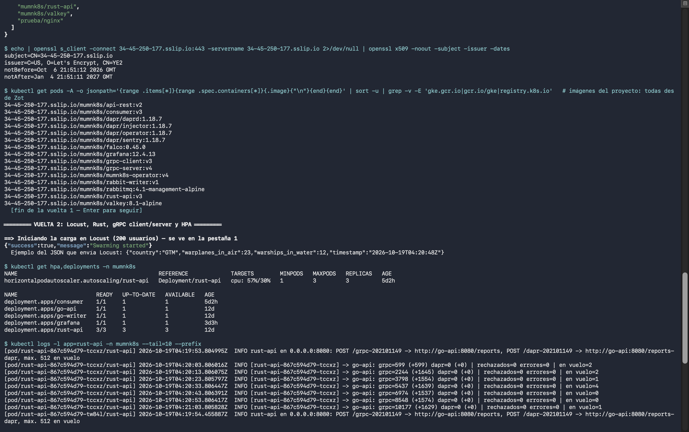
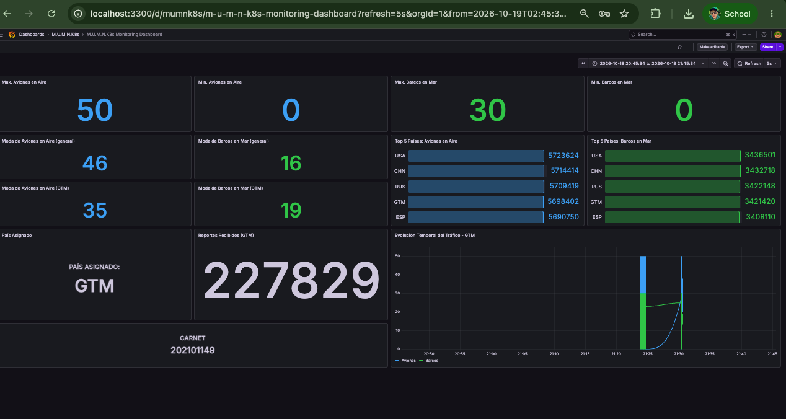

# Manual Técnico. Proyecto 3, Sistemas Operativos 1
## M.U.M.N.K8s: Monitoreo de Unidades Militares en la Nube con Kubernetes

| Campo | Valor |
|---|---|
| Nombre | Mariano Rac |
| Carné | 202101149 |
| País asignado | GTM (último dígito del carné: 9) |
| Ruta principal | `/grpc-202101149` |
| Ruta alterna (opcional) | `/dapr-202101149` |

> Estado del documento: **en construcción**. Cada sección se completa al cerrar su bloque de trabajo. La guía para levantar el entorno está en [GuiaDeInstalacion.md](GuiaDeInstalacion.md).

---

## Índice
1. [Objetivo del proyecto](#1-objetivo-del-proyecto)
2. [Arquitectura general](#2-arquitectura-general)
3. [Conceptos clave](#3-conceptos-clave)
4. [Infraestructura en GCP](#4-infraestructura-en-gcp)
5. [Zot: registry de imágenes](#5-zot-registry-de-imágenes)
6. [Flujo completo de datos](#6-flujo-completo-de-datos)
7. [Kubernetes Gateway API](#7-kubernetes-gateway-api)
8. [Comunicación REST y gRPC](#8-comunicación-rest-y-grpc)
9. [RabbitMQ](#9-rabbitmq)
10. [Operator: Valkey y Grafana](#10-operator-valkey-y-grafana)
11. [HPA](#11-hpa)
12. [OCI Artifact](#12-oci-artifact)
13. [Dashboard de Grafana](#13-dashboard-de-grafana)
14. [Pruebas de carga y análisis de réplicas](#14-pruebas-de-carga-y-análisis-de-réplicas)
15. [Extras: Dapr y Falco](#15-extras-dapr-y-falco)
16. [Problemas encontrados y soluciones](#16-problemas-encontrados-y-soluciones)
17. [Conclusiones](#17-conclusiones)

---

## 1. Objetivo del proyecto

Construir en Google Cloud Platform un sistema distribuido y escalable que recibe en tiempo real reportes militares simulados. Cada reporte indica un país, los aviones de guerra en el aire, los barcos de guerra en el mar y una marca de tiempo. El sistema los procesa, los encola, los almacena y los muestra en un dashboard.

El proyecto demuestra el uso de:
- contenedores y orquestación con **GKE**;
- microservicios en **Rust** y **Go**, comunicados por **REST** y **gRPC**;
- mensajería asíncrona con **RabbitMQ**;
- extensión de Kubernetes con un **Operator** (Operator SDK, basado en Helm) que administra **Valkey** y **Grafana** como Custom Resources;
- un registry privado (**Zot**) en una VM fuera del clúster;
- pruebas de carga con **Locust** y autoescalado con **HPA**.

Ejemplo de mensaje:

```json
{
  "country": "GTM",
  "warplanes_in_air": 42,
  "warships_in_water": 14,
  "timestamp": "2026-03-12T20:15:30Z"
}
```

## 2. Arquitectura general


```
Locust ──HTTP───▶ Gateway API ──/grpc-202101149──▶ API REST (Rust, HPA 1-3)
                                                        │ HTTP
                                                        ▼
                                          Go Deployment 1 (REST + cliente gRPC)
                                                        │ gRPC
                                                        ▼
                                          Go Deployment 2 (servidor gRPC + writer)
                                                        │ AMQP publish
                                                        ▼
                                                    RabbitMQ
                                                        │ AMQP consume
                                                        ▼
                                              Consumer (Go) ──▶ Valkey (CR ValkeyInstance)
                                                                     │
                                                                     ▼
                                                           Grafana (CR GrafanaInstance)

  Zot (VM en GCP, fuera del clúster) ──imágenes por HTTPS──▶ todos los Deployments
```

| Componente | Tecnología | Dónde corre | Estado |
|---|---|---|---|
| Generador de carga | Locust | Máquina local | **Funcionando** (bloque 3) |
| Exposición | Kubernetes Gateway API (GKE) | GKE | **Funcionando** (bloque 3) |
| API REST | Rust, con HPA 1-3 | GKE | **Funcionando** (bloques 2 y 3) |
| Deployment 1 | Go: REST + cliente gRPC | GKE | **Funcionando** (bloque 2) |
| Deployment 2 | Go: servidor gRPC + writer de RabbitMQ | GKE | **Funcionando** (bloque 4) |
| Broker | RabbitMQ 4.1 (StatefulSet) | GKE | **Funcionando** (bloque 4) |
| Consumer | Go | GKE | **Funcionando**: lee la cola y escribe en Valkey (bloques 4 y 5) |
| Almacenamiento | Valkey 8.1, CR `ValkeyInstance` del operador propio | GKE | **Funcionando** (bloque 5) |
| Visualización | Grafana 12.4, CR `GrafanaInstance` del mismo operador | GKE | **Funcionando** (bloque 6) |
| Registry | Zot v2.1.22 | VM `zot-vm` | **Funcionando** |
| OCI Artifact | Configuración de Locust en `mumnk8s/locust-config:v1` | Zot | **Funcionando** (sección 12) |
| Flujo alterno (extra) | Dapr 1.18.7: pub/sub sobre RabbitMQ en `/dapr-202101149` | GKE | **Funcionando** (sección 15.1) |
| Seguridad (extra) | Falco 0.45.0 con regla propia | GKE (DaemonSet) | **Funcionando** (sección 15.2) |

## 3. Conceptos clave

| Concepto | Qué es | Para qué se usa en el proyecto |
|---|---|---|
| **Contenedor / imagen OCI** | Un paquete con una aplicación y sus dependencias. OCI es el estándar abierto del formato | Cada servicio (Rust, Go, consumer, operator) es una imagen |
| **Registry** | Un servidor que almacena imágenes, como Docker Hub | Zot guarda todas las imágenes del proyecto |
| **Kubernetes (K8s)** | Un orquestador: decide en qué nodo corre cada contenedor, los reinicia si fallan y los escala | Es la base de todo el sistema |
| **GKE** | Kubernetes administrado por Google: Google opera el *control plane* y nosotros solo los nodos | El clúster `so1-p3` |
| **Nodo** | Una VM que ejecuta pods. En GKE corre kubelet y containerd | 3 nodos `n1-standard-2` |
| **Pod / Deployment / Service** | Pod: uno o más contenedores que comparten red. Deployment: mantiene N réplicas de un pod. Service: IP y DNS estables frente a pods que cambian | Cada microservicio |
| **Gateway API** | El sucesor de Ingress para exponer servicios HTTP, con recursos `Gateway` y `HTTPRoute` | La entrada pública de Locust |
| **REST vs. gRPC** | REST: JSON sobre HTTP/1.1, fácil de leer. gRPC: Protobuf binario sobre HTTP/2, con contrato tipado (`.proto`) y más eficiente | Rust → Go por REST; Go → Go por gRPC |
| **Message broker** | Un intermediario que desacopla a quien produce mensajes de quien los consume, usando colas | RabbitMQ amortigua los picos de carga |
| **HPA** | Horizontal Pod Autoscaler: agrega o quita réplicas según el uso de CPU | API de Rust: 1 a 3 réplicas cuando la CPU pasa del 30 % |
| **CRD / Custom Resource** | Extienden la API de Kubernetes con tipos nuevos, por ejemplo `ValkeyInstance` | Valkey y Grafana se piden de forma declarativa |
| **Operator** | Un controlador que **reconcilia** el estado deseado (el CR) con el estado real del clúster | Crea, actualiza y borra Valkey y Grafana |
| **Helm chart** | Una plantilla parametrizada de manifiestos de Kubernetes | El Operator basado en Helm instala el chart con los valores del CR |
| **PVC** | PersistentVolumeClaim: una solicitud de disco persistente que sobrevive al pod | Los datos de Valkey |
| **TLS / HTTPS** | Cifrado y verificación de identidad del servidor mediante un certificado firmado por una CA | Zot usa un certificado de Let's Encrypt |

## 4. Infraestructura en GCP

| Recurso | Valor |
|---|---|
| Proyecto | `so1-p3-202101149` |
| Región / zona | `us-central1` / `us-central1-c` |
| Clúster | `so1-p3`, GKE Standard zonal, Kubernetes 1.35 |
| Nodos | 3 × `n1-standard-2` (2 vCPU, 7.5 GB), disco `pd-standard` de 50 GB |
| Gateway API | Canal `standard` (`--gateway-api standard`) |
| VM de Zot | `zot-vm`, `n1-standard-1`, Ubuntu 24.04, disco de 30 GB |
| IP estática de Zot | `34.45.250.177` |

Decisiones de diseño:
- **Clúster zonal.** La gestión de un clúster zonal entra en el nivel gratuito de GKE; uno regional triplicaría los nodos.
- **Disco `pd-standard` de 50 GB.** El disco por defecto (`pd-balanced` de 100 GB) cuenta contra la cuota de SSD de 250 GB, y con 3 nodos sumaría 300 GB.
- **Zona `us-central1-c`.** En `us-central1-a` y `us-central1-b` no había capacidad para máquinas N1 (`ZONE_RESOURCE_POOL_EXHAUSTED`).


## 5. Zot: registry de imágenes

Zot es un registry OCI ligero. Corre como contenedor dentro de la VM `zot-vm`, **fuera del clúster**, y sirve HTTPS directamente.

| Aspecto | Implementación |
|---|---|
| Dominio | `34-45-250-177.sslip.io`. sslip.io es un DNS público que resuelve el nombre a la IP incluida en él |
| Certificado | Let's Encrypt, obtenido con `certbot --standalone` mediante el reto HTTP-01 en el puerto 80 |
| Renovación | Un *deploy hook* de certbot copia el certificado nuevo a `/opt/zot/tls` y reinicia Zot |
| Puertos | 443 en la VM, que redirige al 5000 del contenedor. Regla de firewall `allow-zot` (tcp:80,443) |
| Autenticación | `htpasswd` (bcrypt), usuario `admin` |
| Control de acceso | **Lectura anónima** (GKE descarga sin `imagePullSecrets`). Subir y borrar requiere autenticación |
| Persistencia | `/opt/zot/data` en la VM |
| Interfaz web | Extensiones `search` y `ui` habilitadas |

Configuración (`/opt/zot/config.json`, generada por [zot/instalar_zot.sh](zot/instalar_zot.sh)):

```json
{
  "distSpecVersion": "1.1.1",
  "storage": { "rootDirectory": "/var/lib/registry", "gc": true },
  "http": {
    "address": "0.0.0.0", "port": "5000", "realm": "zot",
    "tls": { "cert": "/etc/zot/tls/fullchain.pem", "key": "/etc/zot/tls/privkey.pem" },
    "auth": { "htpasswd": { "path": "/etc/zot/htpasswd" } },
    "accessControl": { "repositories": { "**": {
      "anonymousPolicy": ["read"],
      "defaultPolicy": ["read", "create", "update", "delete"] } } }
  },
  "extensions": { "search": { "enable": true }, "ui": { "enable": true } }
}
```

**Arquitectura de las imágenes.** La máquina de desarrollo es una Mac con Apple Silicon (arm64) y los nodos N1 son x86_64, así que todas las imágenes se construyen para `linux/amd64`. Una imagen arm64 fallaría en GKE con `exec format error`.

Validación del ciclo de push y pull:

| Prueba | Resultado |
|---|---|
| `GET /v2/` por HTTPS | 200, con certificado emitido por Let's Encrypt |
| Push anónimo | 401, rechazado |
| `docker push .../prueba/nginx:v1` con login | Aparece en `/v2/_catalog` |
| Pod en GKE con imagen de Zot | `Successfully pulled image "34-45-250-177.sslip.io/prueba/nginx:v1"` |

Interfaz web de Zot servida por HTTPS (`https://34-45-250-177.sslip.io/home`), con la imagen de prueba `prueba/nginx:v1` publicada para `linux/amd64` y 2 descargas: el pod de prueba de GKE y la verificación.


Catálogo de Zot con las imágenes del proyecto. Se ven `mumnk8s/grpc-server` (v4), `mumnk8s/grpc-client` (v3) y `mumnk8s/rust-api` (v3), todas `linux/amd64`, con sus descargas desde GKE. También aparece `mumnk8s/falco/container` (0.7.4), el plugin de Falco: un artifact OCI que no es imagen, por eso no muestra arquitectura (sección 15.2).


## 6. Flujo completo de datos

Todos los componentes viven en el namespace `mumnk8s`.

| # | Origen → destino | Protocolo | Formato | Dirección |
|---|---|---|---|---|
| 1 | Locust → Gateway API | HTTPS | JSON | IP pública del Gateway, `/grpc-202101149` _(bloque 3)_ |
| 2 | Gateway → `rust-api` | HTTP | JSON | `rust-api:8080/grpc-202101149` |
| 3 | `rust-api` → `go-api` (contenedor `api-rest`) | HTTP/1.1 REST | JSON | `http://go-api:8080/reports` |
| 4 | `api-rest` → `grpc-client` (mismo pod) | gRPC | Protobuf | `localhost:50050` |
| 5 | `grpc-client` → `go-writer` (contenedor `grpc-server`) | gRPC (HTTP/2) | Protobuf | `dns:///go-writer-grpc.mumnk8s.svc.cluster.local:50051` |
| 6 | `grpc-server` → `rabbit-writer` → RabbitMQ | AMQP | JSON | _(bloque 4)_ |
| 7 | RabbitMQ → consumer → Valkey | AMQP / RESP | | _(bloque 5)_ |
| 8 | Valkey → Grafana | RESP (plugin `redis-datasource`) | | `redis://valkey:6379` |

Validación en cada capa:
- **Rust** rechaza con `400` los países fuera de `USA, RUS, CHN, ESP, GTM` y los valores fuera de rango (aviones 0–50, barcos 0–30). Normaliza el país a mayúsculas.
- **api-rest (Go)** convierte el país al enum del `.proto` (`"GTM"` → `Countries_gtm`) y valida que el timestamp sea RFC3339.
- Si una capa posterior falla, la anterior responde `502 Bad Gateway`.

## 7. Kubernetes Gateway API
Manifiesto: [k8s/40-gateway.yaml](k8s/40-gateway.yaml). Sustituye al Ingress Controller y separa la exposición en dos recursos:

| Recurso | Rol | Quién lo administra |
|---|---|---|
| `Gateway` `mumnk8s-gateway` | El balanceador. Con la clase `gke-l7-global-external-managed`, GKE crea un Application Load Balancer externo de Google con IP pública (escucha HTTP en el puerto 80) | Infraestructura |
| `HTTPRoute` `grpc-route` | Las reglas: `PathPrefix /grpc-202101149` y `PathPrefix /dapr-202101149` → Service `rust-api:8080`. Se engancha al Gateway con `parentRefs` | Aplicación |
| `HealthCheckPolicy` `rust-api-hc` | Le indica al balanceador que revise la salud de los pods en `GET /health` | Aplicación |

La ruta se reenvía sin reescribirla, por eso `rust-api` escucha directamente en `/grpc-202101149`. La ruta opcional `/dapr-202101149` es una segunda regla del mismo HTTPRoute, también hacia `rust-api` (sección 15.1).

**¿Por qué la HealthCheckPolicy?** El balanceador de Google no usa las `readinessProbe` del pod, sino sus propios health checks, que por defecto piden `GET /`. Como `rust-api` responde `404` en `/`, sin la política todos los backends quedarían marcados como no sanos y el Gateway respondería `502`.

Verificación:

```bash
kubectl -n mumnk8s get gateway        # PROGRAMMED=True y una IP en ADDRESS
./scripts/20_gateway_ip.sh            # espera la IP y hace un POST de prueba
```

El balanceador tarda entre 3 y 8 minutos en quedar listo después del `apply`.

## 8. Comunicación REST y gRPC

### 8.1 Contrato gRPC
[proto/warreport.proto](proto/warreport.proto) es la propuesta del enunciado (paquete `wartweets`, servicio `WarReportService.SendReport`). El código Go se genera con:

```bash
cd go-services
protoc -I ../proto --go_out=proto --go_opt=paths=source_relative \
       --go-grpc_out=proto --go-grpc_opt=paths=source_relative ../proto/warreport.proto
```

**Todos los saltos gRPC usan el mismo servicio `WarReportService`.** Cada contenedor es servidor del salto anterior y cliente del siguiente, así que la interfaz no cambia a lo largo de la cadena.

### 8.2 API REST en Rust ([rust-api/src/main.rs](rust-api/src/main.rs))
| Aspecto | Implementación |
|---|---|
| Framework | `axum` 0.8 sobre `tokio`, un runtime asíncrono multihilo |
| Rutas | `POST /grpc-202101149` (la ruta llega igual desde el Gateway) y `GET /health` para las probes |
| Rutas extra | `POST /dapr-202101149` → `go-api /reports-dapr` (flujo Dapr, sección 15.1) |
| Reenvío | `reqwest::Client` compartido (`Arc`), con pool de conexiones keep-alive y timeout de 5 s |
| Protección | `tokio::sync::Semaphore` con `MAX_EN_VUELO` (512) permisos: si hay demasiados reportes esperando a `go-api`, responde `503` al instante en vez de acumularlos (sección 14.3) |
| Memoria | Límite de 512Mi: la mayor parte la ocupan las ~8 800 conexiones keep-alive que mantiene el balanceador de Google (sección 14.3) |
| Configuración | Variables de entorno `CARNET`, `GO_API_URL`, `GO_API_DAPR_URL`, `MAX_EN_VUELO`, `HTTP_ADDR` |
| Logs | Cada 10 s, un resumen por pod: `-> go-api: grpc=N (+x) dapr=M (+y) \| rechazados=R errores=E \| en vuelo=K` (sin colores ANSI, para leerlo con `kubectl logs -l app=rust-api`) |
| Imagen | Binario estático `x86_64-unknown-linux-musl` compilado con `cargo-zigbuild` en una imagen `alpine` |

### 8.3 Deployment 1: `go-api` (2 contenedores)
Los dos contenedores del pod comparten el mismo *network namespace*, así que se comunican por `localhost`.

| Contenedor | Rol | Concurrencia |
|---|---|---|
| `api-rest` ([cmd/api-rest](go-services/cmd/api-rest/main.go)) | HTTP `:8080`. Recibe el JSON de Rust, lo valida, lo convierte a protobuf y llama a `SendReport` en `localhost:50050` | `net/http` atiende cada petición en una goroutine; usa una sola conexión gRPC (HTTP/2) multiplexada y contadores `atomic` |
| `grpc-client` ([cmd/grpc-client](go-services/cmd/grpc-client/main.go)) | **Patrón ambassador**: expone `WarReportService` solo en `localhost:50050` y reenvía cada llamada al gRPC Server del Deployment 2 | El servidor gRPC atiende cada llamada en una goroutine; una sola `ClientConn` hacia el upstream, con balanceo `round_robin` |

¿Por qué un ambassador? Toda la lógica de la conexión remota (descubrimiento por DNS, balanceo entre réplicas y timeouts) queda en un solo contenedor. `api-rest` no sabe dónde vive el servidor.

### 8.4 Deployment 2: `go-writer`
| Contenedor | Rol |
|---|---|
| `grpc-server` ([cmd/grpc-server](go-services/cmd/grpc-server/main.go)) | gRPC `:50051`. Recibe los reportes del Deployment 1 y los reenvía al `rabbit-writer` por `localhost:50052`. Registra cada 10 s el total atendido por la réplica. Expone `grpc.health.v1` (lo usa la `readinessProbe` gRPC nativa) y *reflection* (para probarlo con `grpcurl`) |
| `rabbit-writer` ([cmd/rabbit-writer](go-services/cmd/rabbit-writer/main.go)) | gRPC solo en `localhost:50052`. Convierte el reporte a JSON y lo publica en RabbitMQ (sección 9) |

Es el mismo patrón del Deployment 1: cada contenedor tiene una sola responsabilidad y se comunican por `localhost`. Los errores se propagan hacia atrás: si RabbitMQ no confirma un mensaje, el writer responde `Unavailable`, el grpc-server lo reenvía y Locust ve un error en lugar de un falso `200`.

### 8.5 Balanceo gRPC entre réplicas
gRPC usa conexiones HTTP/2 **persistentes**. Con un Service normal (ClusterIP), kube-proxy balancea **conexiones**, no peticiones: el cliente abre una sola conexión y **todo el tráfico va a una réplica**, aunque haya dos.

Solución aplicada:
1. **Service headless** `go-writer-grpc` (`clusterIP: None`). El DNS devuelve la IP de cada pod.
2. **El cliente usa `dns:///…` con `round_robin`**: abre una conexión por pod y reparte las llamadas.
3. **`MaxConnectionAge: 30s` en el servidor.** El resolver DNS de grpc-go no vuelve a consultar por su cuenta. Al cerrar el servidor las conexiones cada 30 s (con GOAWAY), el cliente vuelve a resolver y descubre las réplicas nuevas tras un escalado.

Prueba con `go-writer` en 2 réplicas y 1000 peticiones (25 concurrentes):

| Réplica | Reportes atendidos |
|---|---|
| `go-writer-849d95595c-d2djb` | 500 |
| `go-writer-849d95595c-gq472` | 500 |

Antes de agregar `MaxConnectionAge`, la réplica nueva recibió **0** reportes: el cliente seguía conectado solo a la original.

### 8.6 Pruebas del bloque 2
| Prueba | Resultado |
|---|---|
| Reporte válido (`GTM`, 42, 14) | `200 reporte enviado` |
| País `MEX` | `400 país no soportado: MEX` |
| `warplanes_in_air: 99` | `400 warplanes_in_air fuera de rango (0-50)` |
| `grpcurl` directo al servidor | `{"status": "recibido por <pod>"}` |
| 1000 peticiones concurrentes en GKE | 1000 × `200` |

## 9. RabbitMQ
Manifiestos: [k8s/05-rabbitmq.yaml](k8s/05-rabbitmq.yaml) (broker) y [k8s/60-consumer.yaml](k8s/60-consumer.yaml) (consumer). Código compartido de la topología: [internal/mq/mq.go](go-services/internal/mq/mq.go).

### 9.1 Despliegue del broker
| Decisión | Motivo |
|---|---|
| **StatefulSet** con 1 réplica, y no Deployment | RabbitMQ tiene estado. El pod siempre se llama `rabbitmq-0` y RabbitMQ guarda sus datos bajo el nombre del nodo (`rabbit@rabbitmq-0`); con un nombre aleatorio no reconocería sus propios datos al reiniciar |
| `volumeClaimTemplates` de 2Gi en `/var/lib/rabbitmq` | Cada réplica obtiene su PVC. Los mensajes persistentes sobreviven al reinicio del pod |
| Imagen `rabbitmq:4.1-management-alpine` **espejada en Zot** | El clúster descarga todo desde el registry propio ([scripts/11_mirror_externas.sh](scripts/11_mirror_externas.sh)). La variante `management` trae la UI web en el puerto 15672 |
| Credenciales en el Secret `rabbitmq-cred` | Las genera [scripts/30_rabbitmq_secret.sh](scripts/30_rabbitmq_secret.sh) y quedan en `.secrets/`, fuera de git. Los pods arman la URL con `$(RABBITMQ_USER)` y `$(RABBITMQ_PASS)`, que Kubernetes expande |
| Probes con `rabbitmq-diagnostics` | `ping` (liveness) revisa que el nodo esté vivo y `check_port_connectivity` (readiness) que acepte conexiones AMQP |

### 9.2 Topología
```
rabbit-writer ──publish (clave "report")──▶ exchange "war_reports" (direct)
                                                  │ binding "report"
                                                  ▼
                                            cola "war_reports" (durable) ──▶ consumer(s)
```

- El **productor publica en un exchange**, no en la cola. El exchange decide a qué colas va cada mensaje según la clave y los bindings. Así se podría agregar otra cola (por ejemplo, una de auditoría) sin tocar el writer.
- Exchange y cola son `durable` y los mensajes se publican como `Persistent`: sobreviven a un reinicio de RabbitMQ.
- Tanto el writer como el consumer declaran la topología al conectarse. La declaración es idempotente, así que no importa cuál arranque primero.

### 9.3 Writer: publisher confirms
El `rabbit-writer` activa el **modo confirm** del canal: RabbitMQ envía un `ack` cuando ya tomó la responsabilidad del mensaje. El writer espera ese `ack` antes de responder por gRPC, así que un `200` en Locust implica que el reporte quedó guardado en la cola. Todas las goroutines (una por llamada gRPC) comparten el mismo canal AMQP.

### 9.4 Consumer
| Aspecto | Implementación |
|---|---|
| Concurrencia | Pool de 8 goroutines (`WORKERS`) que leen del mismo canal de entregas |
| `ack` manual | Se confirma **después** de procesar. Si el pod muere a mitad, RabbitMQ reentrega los mensajes sin `ack` a otro consumer |
| Prefetch (`Qos`) | Máximo de `WORKERS × 10` mensajes sin `ack` por consumer. Limita la memoria del pod y reparte la carga entre réplicas |
| Mensaje inválido | `Nack` sin reencolar: si volviera a la cola, fallaría para siempre |
| Conexión perdida | El proceso termina y Kubernetes reinicia el contenedor (más simple que reconectar a mano). Al arrancar reintenta cada 3 s mientras RabbitMQ no esté listo |

Desde el bloque 5, el consumer guarda cada reporte en Valkey **antes** del `ack` (sección 10.3). Si Valkey falla, hace `Nack` con reencolado y el mensaje se reintenta.

### 9.5 Pruebas del bloque 4
**Flujo completo** con Locust (100 usuarios durante 60 s):

| Punto | Cantidad |
|---|---|
| Respuestas `200` en Locust | 13 524 (0 fallos, 226 req/s) |
| Publicados por `rabbit-writer` | 13 548 |
| Procesados por el consumer | 13 548 |
| Mensajes en la cola al terminar | 0 |

La diferencia entre Locust y el writer son peticiones que seguían en vuelo cuando Locust se detuvo y que no alcanzó a contar.

**Desacoplamiento: consumer caído.**

```bash
kubectl -n mumnk8s scale deploy/consumer --replicas=0
# Locust 20 s (50 usuarios)
kubectl -n mumnk8s exec rabbitmq-0 -- rabbitmqctl list_queues name messages consumers
kubectl -n mumnk8s scale deploy/consumer --replicas=1
```

| Momento | Mensajes en cola | Consumers |
|---|---|---|
| Consumer apagado, antes de la carga | 0 | 0 |
| Después de 20 s de carga (2 291 × `200` en Locust) | 2 305 | 0 |
| 15 s después de levantar el consumer | 0 | 1 |

Con el consumer caído, Locust siguió recibiendo `200` y los mensajes se acumularon en la cola. Al volver, el consumer procesó los 2 305 pendientes en menos de 10 s. El productor no depende de que el consumidor esté disponible.

## 10. Operator: Valkey y Grafana
Carpeta: [operator/](operator/). Es un operador **propio**, generado con Operator SDK (plugin Helm) según la [guía oficial](https://sdk.operatorframework.io/docs/building-operators/helm/quickstart/), con CRDs y charts escritos para este proyecto. Despliega las **imágenes oficiales** de Valkey y Grafana, espejadas en Zot. El auxiliar confirmó que este enfoque es el esperado.

```bash
operator-sdk init --plugins helm --domain so1.usac --project-name mumnk8s-operator
operator-sdk create api --group mumnk8s --version v1alpha1 --kind ValkeyInstance
```

El segundo comando generó un chart de ejemplo (nginx). Se reemplazó completo por los templates de Valkey.

### 10.1 Cómo funciona un operador basado en Helm
| Pieza | Archivo | Rol |
|---|---|---|
| CRD | [config/crd/bases/](operator/config/crd/bases/mumnk8s.so1.usac_valkeyinstances.yaml) | Registra el tipo nuevo `ValkeyInstance` (grupo `mumnk8s.so1.usac/v1alpha1`) en la API de Kubernetes |
| `watches.yaml` | [operator/watches.yaml](operator/watches.yaml) | Asocia cada *kind* con un chart: `ValkeyInstance` → `helm-charts/valkeyinstance` |
| Chart | [helm-charts/valkeyinstance/](operator/helm-charts/valkeyinstance/) | El estado deseado. El `spec` del CR se usa como `values.yaml` |
| Manager | Deployment `mumnk8s-operator-controller-manager` en `mumnk8s-operator-system` | Imagen `helm-operator` con los charts adentro. Vigila los CR y sus recursos hijos |
| RBAC | [config/rbac/role.yaml](operator/config/rbac/role.yaml) | Permisos del manager: los CR, StatefulSets, Services, ConfigMaps y PVCs, y los Secrets donde Helm guarda los releases |

**Ciclo de reconciliación.** Por cada evento del CR o de un recurso que creó:
1. Lee el `spec` del CR y lo pasa como *values* al chart.
2. Renderiza el chart y lo compara con lo que existe en el clúster (un release de Helm con el nombre del CR).
3. Si no existe, lo instala; si cambió el `spec`, hace `upgrade`; si alguien modificó o borró un recurso hijo, lo restaura.
4. Si se borra el CR, desinstala el release y borra los recursos que creó, salvo los PVC.
5. Escribe el resultado en `status.conditions` del CR (`Deployed`, `InstallSuccessful`, …).

### 10.2 Chart de Valkey
| Template | Qué crea | Detalle |
|---|---|---|
| [configmap.yaml](operator/helm-charts/valkeyinstance/templates/configmap.yaml) | `valkey.conf` | `appendonly yes` (AOF en el PVC), `maxmemory` y `maxmemory-policy` desde el CR |
| [statefulset.yaml](operator/helm-charts/valkeyinstance/templates/statefulset.yaml) | StatefulSet + un PVC por pod | El pod `-0` es el primario; si `replicas ≥ 2`, los demás arrancan con `--replicaof valkey-0.valkey-headless`. La anotación `checksum/config` reinicia los pods si cambia la configuración |
| [service.yaml](operator/helm-charts/valkeyinstance/templates/service.yaml) | `valkey`, `valkey-read`, `valkey-headless` | Escritura (solo el primario, por la etiqueta `pod-name`), lectura (todos los pods) y nombres DNS estables |

CR usado ([k8s/70-valkey.yaml](k8s/70-valkey.yaml)):

```yaml
apiVersion: mumnk8s.so1.usac/v1alpha1
kind: ValkeyInstance
metadata: { name: valkey, namespace: mumnk8s }
spec:
  replicas: 1        # 2 para la prueba de rendimiento con réplica
  maxmemory: 200mb
  persistence: { size: 1Gi }
```

**Expiración de datos (recomendación del enunciado).** La única clave que crece con el tiempo es la serie temporal (`ts:<país>`). Se recorta a unas 5000 entradas (`XADD MAXLEN ~`) y tiene un TTL de 24 h que se renueva en cada escritura. Con `maxmemory-policy volatile-lru`, al llegar a 200 MB Valkey solo puede expulsar claves con TTL, así que los agregados nunca se pierden.

### 10.3 Modelo de datos en Valkey
El consumer ([internal/store/store.go](go-services/internal/store/store.go)) actualiza todas las claves de un reporte en **un solo script Lua**. Lua se ejecuta de forma atómica dentro de Valkey: con varios consumers en paralelo, nadie lee un máximo o una moda a medias ni se pisan las comparaciones.

| Clave | Tipo | Contenido | Panel de Grafana |
|---|---|---|---|
| `max:planes`, `min:planes` | string | Máximo y mínimo general de aviones | Máx./Mín. aviones en aire |
| `max:ships`, `min:ships` | string | Máximo y mínimo general de barcos | Máx./Mín. barcos en mar |
| `freq:planes`, `freq:ships` | sorted set | valor → veces que apareció | (auxiliar de la moda) |
| `mode:planes`, `mode:ships` | string | Valor más frecuente. Se actualiza cuando un valor supera la frecuencia de la moda actual | Moda (general) |
| `freq:planes:GTM`, `mode:planes:GTM` (y `ships`, uno por país) | sorted set / string | Lo mismo, contando solo los reportes de ese país | Moda (GTM) |
| `top:planes`, `top:ships` | sorted set | país → **suma acumulada** (`ZINCRBY`) | Top 5 países |
| `reports:GTM`, `reports:total` | string | Contadores (`INCR`) | Reportes recibidos de GTM |
| `ts:GTM` (uno por país) | stream | Entradas `{planes, ships}`. El ID del stream es la marca de tiempo en ms | Serie temporal de GTM |

El top usa la suma acumulada porque con valores aleatorios entre 0 y 50, el máximo por país sería 50 para todos y el promedio rondaría 25 en todos.

El enunciado dice "general" para el máximo y el mínimo, pero no para la moda. Por eso el dashboard muestra las dos: la moda general (todos los países) y la del país asignado. Las dos se calculan con la misma función Lua, cambiando solo el sufijo de la clave.

`valkey-go` hace *pipelining* automático: los 8 workers comparten una conexión y sus comandos viajan juntos. Cada script se envía con `EVALSHA` (solo el hash).

### 10.4 Pruebas del bloque 5
**Reconciliación.** Después de `kubectl apply -f k8s/70-valkey.yaml`:

```
$ kubectl -n mumnk8s get valkeyinstance valkey -o jsonpath='{.status.conditions[*].reason}'
InstallSuccessful
$ kubectl -n mumnk8s get sts,svc,pvc,cm
statefulset.apps/valkey   1/1
service/valkey  service/valkey-headless  service/valkey-read
persistentvolumeclaim/data-valkey-0   Bound   1Gi
configmap/valkey-config
```

**Autocorrección y persistencia.** Se guardó una clave de prueba y se borró el StatefulSet a mano (`kubectl delete sts valkey`). El operador lo recreó en unos 10 s; el pod nuevo montó el mismo PVC y la clave seguía ahí (recuperada del AOF).

**Datos tras 45 s de Locust (100 usuarios):**

| Clave | Valor |
|---|---|
| `reports:total` | 10 045 (igual a lo procesado por el consumer) |
| `reports:GTM` | 2017 |
| `max:planes` / `min:planes` | 50 / 0 |
| `max:ships` / `min:ships` | 30 / 0 |
| `mode:planes` / `mode:ships` | 31 / 26 |
| `top:planes` | USA 51 841, CHN 51 512, RUS 50 407, GTM 49 951, ESP 48 711 |
| `ts:GTM` | 2017 entradas, TTL 86 373 s |
| Memoria usada | 1.52 MB |

### 10.5 Chart de Grafana
Es un segundo *kind* dentro del **mismo operador**:

```bash
operator-sdk create api --group mumnk8s --version v1alpha1 --kind GrafanaInstance
```

El comando agregó el CRD `grafanainstances`, una entrada en `watches.yaml` (`GrafanaInstance` → `helm-charts/grafanainstance`) y sus reglas en `role.yaml`. Como con Valkey, el chart nginx de ejemplo se reemplazó completo. De las reglas generadas solo se dejaron las del CR: los recursos que crea el chart ya estaban cubiertos por las reglas de Valkey.

| Template | Qué crea | Detalle |
|---|---|---|
| [configmap.yaml](operator/helm-charts/grafanainstance/templates/configmap.yaml) | `grafana-provisioning`, `grafana-dashboards` | El datasource `Valkey` (plugin `redis-datasource` 2.2.0, `redis://valkey:6379`), el proveedor de dashboards y el JSON del dashboard ([files/dashboard.json](operator/helm-charts/grafanainstance/files/dashboard.json)) |
| [deployment.yaml](operator/helm-charts/grafanainstance/templates/deployment.yaml) | Deployment de 1 réplica | Imagen oficial `grafana/grafana:12.4.13` espejada en Zot. Un **initContainer** instala el plugin con `grafana cli` en el volumen compartido, así no se necesita una imagen propia. Usuario y clave admin desde el Secret `grafana-admin`. La anotación `checksum/config` recrea el pod si cambia el dashboard |
| [service.yaml](operator/helm-charts/grafanainstance/templates/service.yaml) | Service `grafana` (ClusterIP, puerto 80 → 3000) | Se accede con `kubectl port-forward` |

**¿Por qué provisioning y no configurarlo en la UI?** Grafana lee los archivos de `/etc/grafana/provisioning` al arrancar. Así el datasource y el dashboard existen apenas se crea el CR, sin pasos manuales, y el volumen de datos puede ser un `emptyDir`: si el pod muere, el nuevo arranca igual.

**El dashboard en `files/` y no en `templates/`.** Grafana usa `{{ }}` en sus propias plantillas, igual que Helm. Por eso el JSON no se procesa con `tpl`: el ConfigMap lo lee con `.Files.Get` y solo reemplaza los marcadores `__PAIS__`, `__CARNET__` y `__REFRESH__` por los valores del CR.

CR usado ([k8s/80-grafana.yaml](k8s/80-grafana.yaml)):

```yaml
apiVersion: mumnk8s.so1.usac/v1alpha1
kind: GrafanaInstance
metadata: { name: grafana, namespace: mumnk8s }
spec:
  valkey: { address: valkey:6379 }
  adminSecret: grafana-admin
  dashboard: { country: GTM, carnet: "202101149", refresh: 5s }
```

**Consultas de cada panel** (plugin `redis-datasource`, tipo *Command*):

| Panel | Consulta | Notas |
|---|---|---|
| Máx./Mín. aviones y barcos | `GET max:planes`, `GET min:planes`, `GET max:ships`, `GET min:ships` | Una transformación convierte el texto a número |
| Moda (general) | `GET mode:planes`, `GET mode:ships` | |
| Moda (GTM) | `GET mode:planes:GTM`, `GET mode:ships:GTM` | Requiere el consumer `v3` |
| Top 5 países | `ZRANGE top:planes 0 4 REV WITHSCORES` | `REV` ordena de mayor a menor. El plugin devuelve un campo por país y el *bar gauge* dibuja una barra por campo |
| Reportes recibidos | `GET reports:GTM` | |
| Evolución temporal | `XRANGE ts:GTM <desde> <hasta>` | El plugin acota el rango con el selector de tiempo del dashboard y convierte el ID de cada entrada (ms) en el eje de tiempo |
| País y carnet | Panel de texto | Valores fijos del CR |

## 11. HPA
Manifiesto: [k8s/50-hpa.yaml](k8s/50-hpa.yaml). Escala `rust-api` entre **1 y 3 réplicas** con un objetivo de **30 % de CPU**.

- El porcentaje se calcula sobre `requests.cpu` (100m), así que el umbral es de unos 30m por pod. Por eso el Deployment debe tener los `requests` definidos.
- `metrics-server` (incluido en GKE) mide el consumo de cada pod y el HPA lo consulta cada 15 s.
- Fórmula: `réplicas = ceil(réplicas_actuales × uso_actual / uso_objetivo)`. Ejemplo: 1 réplica al 138 % da ceil(1 × 138 / 30) = 5, y se recorta al máximo de 3.
- Al bajar la carga, el HPA espera la ventana de estabilización (5 min por defecto) antes de reducir réplicas, para no oscilar.

### 11.1 Prueba de escalado
Locust sin interfaz con 200 usuarios (20 por segundo) durante 4 minutos contra la IP del Gateway:

```bash
locust -f locust/locustfile.py --host http://<IP_GATEWAY> --headless -u 200 -r 20 -t 4m
kubectl -n mumnk8s get hpa rust-api -w      # en otra terminal
```

| Hora | CPU promedio / objetivo | Réplicas |
|---|---|---|
| 19:41:46 | 0 % / 30 % | 1 |
| 19:42:08 | 34 % / 30 % | 2 |
| 19:42:29 | 138 % / 30 % | 3 |
| 19:43:52 | 70 % / 30 % | 3 |
| 19:45:58 | 45 % / 30 % | 3 |

Resultado de Locust: **109 623 peticiones**, unas **464 req/s**, mediana de 110 ms y p95 de 150 ms. Hubo 3 fallos (`503`, 0.00 %), atribuibles a la ventana en que el balanceador integraba las réplicas nuevas.

Observaciones:
- El escalado de 1 a 3 réplicas tomó **menos de 45 s**.
- Al aparecer las réplicas nuevas, la carga se repartió de forma pareja (unos 45m de CPU en cada pod `rust-api`).
- El cuello de botella siguiente es `go-api` (unos 550m entre sus dos contenedores), que no tiene HPA porque el enunciado solo lo pide para Rust.
- La CPU promedio se quedó en 45 %, por encima del 30 %, pero el HPA no puede pasar de `maxReplicas: 3`.
- Al terminar la carga, la CPU bajó a 0-1 %, pero el HPA mantuvo 3 réplicas durante la ventana de estabilización y volvió a **1 réplica** a las 19:53. La espera se alargó porque un rollout a las 19:47 (el cambio de memoria) generó un pico de arranque y reinició la ventana de 5 min.

Ensayo de la calificación ([scripts/90_calificacion.sh](scripts/90_calificacion.sh), vueltas 1 y 2):
- **Vuelta 1:** el certificado de Let's Encrypt de Zot y la lista de imágenes que usa el clúster; todas vienen de `34-45-250-177.sslip.io/mumnk8s/...`.
- **Vuelta 2:** con 200 usuarios de Locust, el HPA está en **3 réplicas con 57 % de CPU** (objetivo: 30 %). El log de `rust-api` muestra el resumen cada 10 s: ~1 600 reportes reenviados a `go-api` por intervalo, sin rechazados ni errores.



## 12. OCI Artifact

Un registry OCI no guarda solo imágenes: guarda cualquier contenido descrito por un manifiesto. Un **OCI Artifact** usa el mismo manifiesto que una imagen, pero con un `artifactType` propio y capas que no son sistemas de archivos.

**Qué archivo es.** [locust/war-config.json](locust/war-config.json), la configuración del generador de carga:

```json
{
  "carnet": "202101149",
  "countries": ["USA", "RUS", "CHN", "ESP", "GTM"],
  "warplanes_in_air": { "min": 0, "max": 50 },
  "warships_in_water": { "min": 0, "max": 30 },
  "wait_time_s": { "min": 0.1, "max": 0.5 },
  "routes": { "grpc": "/grpc-202101149", "dapr": "/dapr-202101149" }
}
```

**Cómo se usa.** [locust/locustfile.py](locust/locustfile.py) no tiene países, rangos ni rutas en el código: los lee de `locust/.artifact/war-config.json`, que solo existe si se descargó el artifact desde Zot (la carpeta `.artifact/` está en `.gitignore`). Si falta, Locust no arranca e indica el comando para bajarlo. La variable `FLUJO=grpc|dapr` elige qué ruta de `routes` se usa. Así, cambiar los rangos o los países de una prueba es publicar una versión nueva del artifact, sin tocar el código.

| Paso | Comando ([scripts/50_oci_artifact.sh](scripts/50_oci_artifact.sh)) | Qué hace |
|---|---|---|
| Publicar | `./scripts/50_oci_artifact.sh push` | `oras push .../mumnk8s/locust-config:v1 --artifact-type application/vnd.mumnk8s.locust.config.v1+json war-config.json:application/json` |
| Inspeccionar | `./scripts/50_oci_artifact.sh ver` | `oras manifest fetch` y lista de repositorios |
| Descargar | `./scripts/50_oci_artifact.sh pull` | `oras pull` a `locust/.artifact/` |
| Usar | `locust -f locust/locustfile.py --host http://34.54.242.227` | Locust lee el JSON descargado |

Manifiesto guardado en Zot (`oras manifest fetch --pretty`):

```json
{
  "schemaVersion": 2,
  "mediaType": "application/vnd.oci.image.manifest.v1+json",
  "artifactType": "application/vnd.mumnk8s.locust.config.v1+json",
  "config": {
    "mediaType": "application/vnd.oci.empty.v1+json",
    "digest": "sha256:44136fa355b3678a1146ad16f7e8649e94fb4fc21fe77e8310c060f61caaff8a",
    "size": 2,
    "data": "e30="
  },
  "layers": [
    {
      "mediaType": "application/json",
      "digest": "sha256:7312d3427bd73862d0ceab761026dd52bda5899291dcca57698508da94e04389",
      "size": 300,
      "annotations": { "org.opencontainers.image.title": "war-config.json" }
    }
  ],
  "annotations": {
    "org.opencontainers.image.created": "2026-10-19T02:06:53Z",
    "org.opencontainers.image.description": "Configuración de Locust (carnet 202101149)"
  }
}
```

Diferencias con una imagen:

| Campo | Imagen | Este artifact |
|---|---|---|
| `artifactType` | No tiene | `application/vnd.mumnk8s.locust.config.v1+json`. Identifica qué es el contenido |
| `config` | JSON con arquitectura, `Entrypoint`, variables, etc. | `application/vnd.oci.empty.v1+json`: un `{}` de 2 bytes (`e30=` en base64). No hay nada que ejecutar |
| Capas | `tar.gz` con sistemas de archivos | Un solo blob `application/json` de 300 bytes |
| `org.opencontainers.image.title` | No se usa | Nombre del archivo; `oras pull` lo usa para recrear `war-config.json` |

Salida del `pull`:

```text
Downloading 7312d3427bd7 war-config.json
Downloaded  7312d3427bd7 war-config.json
Pulled [registry] 34-45-250-177.sslip.io/mumnk8s/locust-config:v1
Digest: sha256:cdc397161273e76a7563e1eab2397b95fc6efd70cf719e1ab2fb89d78ee8e86f
```

El repositorio `locust-config` aparece en Zot junto a las imágenes (`oras repo ls`): `api-rest`, `consumer`, `grafana`, `grpc-client`, `grpc-server`, `locust-config`, `mumnk8s-operator`, `rabbit-writer`, `rabbitmq`, `rust-api` y `valkey`.

Falco usa el mismo mecanismo (sección 15.2): sus reglas y su plugin de contenedores también son artifacts OCI y se descargan desde Zot.

## 13. Dashboard de Grafana

El dashboard lo crea el operador a partir del CR `GrafanaInstance` (sección 10.5): el datasource de Valkey y el JSON del dashboard se provisionan por ConfigMap, sin pasos manuales en la interfaz. Se abre en `http://localhost:3300/d/mumnk8s` con `kubectl -n mumnk8s port-forward svc/grafana 3300:80` (o con [scripts/90_calificacion.sh](scripts/90_calificacion.sh), que deja el port-forward abierto).



| Panel | Clave en Valkey | Valor en la captura | Lectura |
|---|---|---|---|
| Máx. / Mín. Aviones en Aire | `max:planes`, `min:planes` | 50 / 0 | Extremos de todos los reportes |
| Máx. / Mín. Barcos en Mar | `max:ships`, `min:ships` | 30 / 0 | Extremos de todos los reportes |
| Moda de Aviones / Barcos (general) | `mode:planes`, `mode:ships` | 46 / 16 | Valor más repetido en todos los países |
| Moda de Aviones / Barcos (GTM) | `mode:planes:GTM`, `mode:ships:GTM` | 35 / 19 | Valor más repetido solo en los reportes de GTM |
| Top 5 Países: Aviones / Barcos | `top:planes`, `top:ships` (`ZRANGE ... REV WITHSCORES`) | USA 5 723 624 aviones y 3 436 501 barcos al frente | Suma acumulada por país |
| País Asignado y Carnet | Panel de texto (marcadores `__PAIS__` y `__CARNET__` del chart) | GTM, 202101149 | Último dígito del carné: 9 → GTM |
| Reportes Recibidos (GTM) | `reports:GTM` | 227 829 | Total de reportes del país asignado |
| Evolución Temporal del Tráfico - GTM | `ts:GTM` (stream, `XRANGE`) | Dos ráfagas, a las 21:24 y a las 21:30 | Un punto por reporte de GTM: aviones en azul, barcos en verde |

**¿Por qué el mínimo es 0 y el máximo 50 (y 30)?** Locust genera valores con los rangos sugeridos por el enunciado: aviones entre 0 y 50 y barcos entre 0 y 30, definidos en el OCI Artifact, sección 12. Con más de un millón de reportes aleatorios, los extremos se alcanzan desde los primeros segundos. Los valores del dashboard de ejemplo del enunciado (mínimo de 42, máximo de 1 450) son simulados (el título dice "SIMULATED") y quedan fuera de esos rangos. Por la misma razón, los totales del Top 5 son parecidos entre países: Locust elige el país de forma uniforme y las sumas convergen.

**La serie temporal** muestra los periodos con tráfico dentro del rango del dashboard (últimos 30 min). Entre las pruebas no hubo reportes, por eso aparecen ráfagas y no una línea continua. El stream guarda las últimas ~5 000 entradas por país, con TTL de 24 h (sección 10.3).

**Alertas de Falco.** Debajo de estos paneles hay una fila de seguridad: los contadores `falco:total:mumnk8s` (regla propia) y `falco:total`, y la tabla de las últimas alertas, leída del stream `falco:alertas` con `XREVRANGE`. Las alertas llegan desde Falco por `http_output` a `falco-bridge` (sección 15.2).

## 14. Pruebas de carga y análisis de réplicas

### 14.1 Metodología
Script: [scripts/60_pruebas_replicas.sh](scripts/60_pruebas_replicas.sh). En cada escenario el script:

1. Fija las réplicas de `go-writer` (`kubectl scale`) y de Valkey (`spec.replicas` del CR `ValkeyInstance`; el operador reconcilia el StatefulSet) y espera a que estén listas.
2. Espera 35 s para que el cliente gRPC vuelva a resolver el DNS del Service headless y vea todas las réplicas (sección 8.5).
3. Corre Locust *headless* contra el Gateway con la configuración bajada del OCI Artifact (sección 12).
4. Cada 5 s guarda la profundidad de las colas de RabbitMQ (`rabbitmqctl list_queues`) y la CPU y memoria de cada contenedor (`kubectl top pods --containers`).

`rust-api` se fija en 3 réplicas durante las pruebas (HPA con `minReplicas = maxReplicas = 3`) para que el HPA no escale a mitad de una corrida: así la única variable es la que se mide. Al terminar, el script restaura el HPA (1-3) y deja 1 `go-writer` y 1 Valkey.

Los resultados de cada escenario (CSV de Locust, colas y CPU) están en [pruebas/](pruebas/), una carpeta por escenario.

| Ronda | Usuarios | Procesos de Locust | Duración | `go-api` | Objetivo |
|---|---|---|---|---|---|
| Normal | 150 (25/s) | 1 | 2 min | 1 réplica | Comparar 1 vs. 2 réplicas en `go-writer` y en Valkey |
| Alta | 600 (50/s) | 4 | 2 min | 2 réplicas | Buscar el punto de saturación. Con `go-api` en 2 réplicas, el Deployment 1 deja de ser el primer cuello de botella |

Cada usuario espera entre 0.1 y 0.5 s entre peticiones (`wait_time_s` del artifact), más el tiempo de respuesta (~0.11 s). El máximo teórico es de usuarios / 0.41 s: ~370 req/s con 150 usuarios y ~1 460 con 600. En las dos rondas el throughput medido quedó cerca de ese techo, así que el generador también pone parte del límite.

### 14.2 Ronda normal: 1 vs. 2 réplicas (flujo gRPC)
CPU: promedio en milicores durante la carga, sumando todas las réplicas de cada contenedor.

| Escenario | `go-writer` | Valkey | Peticiones | Fallos | req/s | p50 | p95 | Cola máx. | CPU `go-writer` (server + writer) | CPU Valkey | CPU RabbitMQ |
|---|---|---|---|---|---|---|---|---|---|---|---|
| `w1-v1` | 1 | 1 | 40 737 | 0 | 341.9 | 110 ms | 170 ms | 19 | 202 + 159 = **361m** | 65m | 644m |
| `w2-v1` | 2 | 1 | 40 975 | 0 | 343.4 | 110 ms | 160 ms | 3 | 272 + 212 = **484m** | 69m | 687m |
| `w1-v2` | 1 | 2 | 41 212 | 0 | 345.8 | 110 ms | 150 ms | 5 | 180 + 146 = 326m | **129m** | 660m |
| `w2-v2` | 2 | 2 | 41 462 | 0 | 348.0 | 110 ms | 150 ms | 13 | 270 + 196 = 466m | **129m** | 701m |

El p50 de 110 ms es casi todo latencia de red entre la máquina de Locust y GCP: un `POST` desde dentro del clúster tarda unos pocos milisegundos.

### 14.3 Ronda de alta carga (flujo gRPC)

| Escenario | `go-writer` | Peticiones | Fallos | req/s | p50 | p95 | Cola máx. | CPU `go-api` (2 pods) | CPU `go-writer` | CPU RabbitMQ |
|---|---|---|---|---|---|---|---|---|---|---|
| `alta-w1-v1` (primer intento) | 1 | 150 602 | **46 948 (31 %)** | 1254.6 | 130 ms | 250 ms | 92 | | | |
| `alta-w2-v1` (primer intento) | 2 | 157 796 | **87 314 (55 %)** | 1314.5 | 120 ms | 210 ms | 68 | | | |
| `alta-w1-v1` (límite 384Mi) | 1 | 153 016 | 0 | 1274.8 | 140 ms | 210 ms | 53 | 881m | 363 + 275 = 638m | 749m |
| `alta-w2-v1` (límite 384Mi) | 2 | 148 678 | 0 | 1238.6 | 140 ms | 250 ms | 64 | 1100m | 605 + 453 = 1058m | 849m |
| `alta512-w1-v1` (límite 512Mi, final) | 1 | 154 608 | 0 | 1288.0 | 130 ms | 200 ms | 43 | | | |

**Primer intento: OOMKill en `rust-api`.** Los fallos eran `503` del balanceador. Los 3 pods de `rust-api` terminaron con `OOMKilled` (límite de 256Mi) uno tras otro, y mientras reiniciaban el Gateway no tenía backends sanos. En el segundo escenario fue peor porque los pods entraron en un ciclo de reinicios.

**Primera hipótesis (incompleta):** peticiones en vuelo acumuladas cuando `go-api` se pone lento. Se agregó un `tokio::sync::Semaphore` que limita los reportes en vuelo por pod (`MAX_EN_VUELO = 512`): si no hay permiso libre, responde `503` al instante (*load shedding*). También se subió el límite a 384Mi. La repetición dio 0 fallos, pero la memoria llegó a 380Mi, y en la prueba de Dapr con alta carga (14.4) hubo otro `OOMKilled`.

**Causa real:** en reposo, 15 minutos después de la carga, el pod seguía en 356Mi con **8 774 conexiones TCP establecidas** en el puerto 8080, todas de los nodos del balanceador de Google:

```bash
kubectl -n mumnk8s exec <pod-rust-api> -- sh -c \
  'awk "NR>1 && \$4==\"01\"" /proc/net/tcp /proc/net/tcp6 | wc -l; grep VmRSS /proc/1/status'
# 8774
# VmRSS:   330840 kB
```

El Application Load Balancer abre conexiones desde muchos nodos (GFE) y las mantiene en keep-alive durante 10 minutos. Cada conexión ocupa ~38KB en `rust-api` (la tarea de tokio y los buffers de hyper). La memoria depende de cuántas conexiones abre el balanceador, no de las peticiones en vuelo. Cerrarlas antes desde el backend no es buena idea: Google recomienda que el keep-alive del backend sea mayor que el del balanceador (600 s), para evitar `502` cuando el backend cierra una conexión que el balanceador está reutilizando.

**Corrección final:** límite de memoria de **512Mi** (request de 128Mi), dimensionado con lo medido (pico de 381Mi). La validación (`alta512-w1-v1`) dio **0 fallos a 1 288 req/s, un pico de 305Mi y 0 reinicios**. El semáforo se queda como protección para cuando `go-api` se vuelva lento, aunque no fue lo que resolvió el problema.

### 14.4 Flujo Dapr bajo la misma carga

| Escenario | Peticiones | Fallos | req/s | p50 | p95 | CPU `daprd` (go-api) | CPU RabbitMQ |
|---|---|---|---|---|---|---|---|
| `dapr-w1-v1` | 34 465 | 294 (`404`)* | 287.1 | 200 ms | 380 ms | 193m | 800m |
| `dapr-w2-v1` | 31 050 | 107 (`404`)* | 258.7 | 270 ms | 490 ms | 208m | 823m |
| `dapr500-w1-v1` (sidecar con límite 500m) | 30 758 | 0 | 256.2 | 270 ms | 500 ms | 198m | 903m |
| `dapr-alta-w1-v1` (`go-api` = 2) | 46 768 | 1 822 | 389.6 | 1100 ms | 2100 ms | 311m (límite 300m) | 925m |
| `dapr500-alta-w1-v1` (`go-api` = 2, sidecar 500m) | 41 463 | 1 524 | 345.5 | 1300 ms | 2200 ms | 266m | 862m |

\* Los `404` vinieron del balanceador de Google, no del clúster (`api-rest` registró 0 fallidos). La regla `/dapr-202101149` se había agregado al HTTPRoute minutos antes y algunos nodos del balanceador global todavía tenían el mapa de URL viejo. En la repetición (`dapr500-w1-v1`) hubo 0 fallos.

En alta carga hubo 250 `502` de `go-api` (timeouts esperando a Dapr) y 1 562 `503` concentrados en 4 segundos (02:47:10-02:47:14). En ese mismo momento (02:47:13), un pod de `rust-api` terminó con `OOMKilled` (todavía con el límite de 384Mi). Locust no guarda el cuerpo de la respuesta, así que no se puede separar cuántos `503` vinieron del semáforo y cuántos del balanceador mientras el pod reiniciaba. Esta corrida fue la que llevó a encontrar la causa real de la memoria (sección 14.3).

### 14.5 Análisis

**`go-writer` con 1 vs. 2 réplicas**
- **El tráfico se reparte de forma pareja.** Con 2 réplicas, cada `grpc-server` usó ~145m: el balanceo `round_robin` sobre el Service headless funciona (sección 8.5).
- **No aumenta el throughput.** En las dos rondas el throughput quedó cerca del techo del generador. En la alta, 1 réplica atendió 1275 req/s usando 363m de 500m en `grpc-server` y 275m de 500m en `rabbit-writer`: todavía no estaba saturada. Una segunda réplica no tiene trabajo extra que absorber.
- **Cuesta más CPU en total.** 361m contra 484m en la ronda normal y 638m contra 1058m en la alta. Cada réplica tiene su propia conexión AMQP y su propio canal con confirms, y con dos canales hay menos mensajes por lote de confirmación. RabbitMQ también subió de 749m a 849m.
- **Conclusión:** con esta carga, 2 réplicas no mejoran el rendimiento. Sirven para **disponibilidad** (si un pod muere, el otro sigue recibiendo) y para tener margen cuando `grpc-server` se acerque a su límite de CPU.

**Valkey con 1 vs. 2 réplicas**
- **La CPU total de Valkey se duplica** (65m → 129m). La réplica recibe el flujo de replicación del primario y ejecuta cada escritura otra vez.
- **El throughput y la latencia no cambian.** El consumer escribe siempre en el primario (Service `valkey`) y la réplica es de solo lectura, así que no hay más capacidad de escritura.
- **Lo que gana es lectura y disponibilidad.** Grafana podría leer de la réplica sin competir con el consumer, y si el primario se pierde los datos siguen en la réplica. Con esta carga de escritura, una sola instancia sobra (~65m de 500m).

**gRPC vs. Dapr**
- **El flujo Dapr tiene un techo de ~200 req/s por réplica de `go-api`** (390 con 2), contra más de 1 275 con gRPC directo. La causa está en el componente `pubsub.rabbitmq` de Dapr: `publishSync` toma un mutex y lo mantiene durante el `Publish` y la espera del confirm (`confirm.Wait()`), así que cada sidecar publica **un mensaje a la vez**. Cada publicación persistente espera a que RabbitMQ la escriba y la confirme. Con ~200 mensajes/s por sidecar, eso son unos 5 ms por mensaje. El `rabbit-writer` propio usa *deferred confirms* sin mutex: cientos de publicaciones en vuelo que RabbitMQ confirma en lote.
- **Subir el límite de CPU del sidecar no ayuda** (`dapr500-*`). Con 500m el `daprd` no pasó de 266m y el throughput fue el mismo: el sidecar no estaba limitado por CPU, sino esperando confirms.
- **El broker trabaja el doble.** En el diseño elegido, cada reporte pasa dos veces por RabbitMQ: el exchange de Dapr y después `war_reports`. Por eso RabbitMQ usa 800-900m con solo 250-390 reportes/s.
- **Cada sidecar consume ~200m de CPU**, casi lo mismo que el contenedor de la aplicación al que acompaña.
- **Lo que gana Dapr es desacoplamiento.** `grpc-client` y `grpc-server` no conocen RabbitMQ: solo un nombre de pub/sub y un tópico. Cambiar de broker es editar [k8s/dapr/pubsub.yaml](k8s/dapr/pubsub.yaml). Los reintentos, el formato CloudEvents, el mTLS entre sidecars y los permisos por `scopes` vienen incluidos. El costo es rendimiento, más contenedores y un plano de control más que operar.

**Cuellos de botella**
1. **Ronda normal:** el generador (Locust desde una sola máquina).
2. **Alta carga, antes de la corrección:** la memoria de `rust-api`, por las conexiones del balanceador.
3. **Alta carga, después:** ningún componente llegó a su límite y el throughput quedó cerca del techo del generador (~1 460 req/s). El más cargado en proporción es **RabbitMQ** (749-849m de 1 CPU), por los mensajes persistentes con confirmación; le sigue `grpc-server` (363m de 500m con 1 réplica). Para pasar de ~1 300 req/s, lo primero sería darle más CPU a RabbitMQ. Agregar réplicas de `go-writer` no ayuda (sección anterior).
4. **Flujo Dapr:** la publicación serializada del sidecar y RabbitMQ.

El consumer nunca fue el cuello de botella: la cola máxima fue de 92 mensajes y en la muestra siguiente (5 s después) ya estaba vacía o casi.

## 15. Extras: Dapr y Falco

### 15.1 Dapr: flujo `/dapr-202101149`
Dapr corre como un **sidecar** (`daprd`) junto a cada aplicación. La aplicación le habla por gRPC en `localhost` con el SDK, y el sidecar se encarga del broker, los reintentos y el mTLS. Qué broker se usa no está en el código: lo define un recurso `Component`.

**Diseño.** Dapr reemplaza solo el salto gRPC entre el Deployment 1 y el Deployment 2. El resto del camino es el mismo, así que los datos de ambos flujos llegan a Valkey y Grafana, y la comparación es justa.

```
Locust ──▶ Gateway ──/dapr-202101149──▶ rust-api ──HTTP /reports-dapr──▶ go-api
                                                                          │ api-rest ─gRPC + metadata x-flujo=dapr─▶ grpc-client
                                                                          │ grpc-client ─SDK Dapr PublishEvent─▶ daprd (localhost:50001)
                                                                          ▼
                                            RabbitMQ: exchange war_reports_dapr (fanout) ─▶ cola go-writer-war_reports_dapr
                                                                          │
                                                                          ▼  daprd de go-writer ─gRPC callback─▶ grpc-server (localhost:50060)
                                               grpc-server ─gRPC─▶ rabbit-writer ─▶ war_reports ─▶ consumer ─▶ Valkey ─▶ Grafana
```

| Pieza | Archivo | Qué hace |
|---|---|---|
| Plano de control | [k8s/dapr/values.yaml](k8s/dapr/values.yaml) | Chart oficial `dapr/dapr` 1.18.7 con imágenes de Zot (`global.registry`). Solo `dapr-operator`, `dapr-sentry` (certificados mTLS) y `dapr-sidecar-injector`. *Actors* (placement) y *scheduler* (3 pods con etcd y un PVC de 16Gi cada uno) se apagaron porque solo se usa pub/sub |
| Component | [k8s/dapr/pubsub.yaml](k8s/dapr/pubsub.yaml) | `pubsub-rabbitmq` de tipo `pubsub.rabbitmq`, con las credenciales del Secret `rabbitmq-cred`, mensajes persistentes, `publisherConfirm` y `scopes: [go-api, go-writer]` |
| Ruta | [k8s/40-gateway.yaml](k8s/40-gateway.yaml) | Segunda regla del HTTPRoute: `PathPrefix /dapr-202101149` → `rust-api` |
| Rust | [rust-api/src/main.rs](rust-api/src/main.rs) | `POST /dapr-202101149` valida igual que la ruta gRPC y reenvía a `go-api /reports-dapr` |
| Publicador | [cmd/api-rest](go-services/cmd/api-rest/main.go) y [cmd/grpc-client](go-services/cmd/grpc-client/main.go) | `api-rest` agrega la metadata gRPC `x-flujo: dapr`. El ambassador `grpc-client` la lee y, en vez de llamar al Deployment 2, publica con `client.PublishEvent(ctx, "pubsub-rabbitmq", "war_reports_dapr", reporte)` del SDK `github.com/dapr/go-sdk`. El cliente de Dapr se crea en la primera publicación porque el sidecar puede arrancar después que el contenedor |
| Suscriptor | [cmd/grpc-server](go-services/cmd/grpc-server/main.go) | Con `DAPR_APP_ADDR=localhost:50060` levanta el servicio de callbacks del SDK (`service/grpc`) y se suscribe con `AddTopicEventHandler`. Cada evento se convierte a protobuf y se manda al `rabbit-writer`. Si falla, devuelve `retry=true` y Dapr vuelve a entregar el mensaje; si el JSON es inválido, lo descarta (`DROP`) |
| Inyección del sidecar | [k8s/20-go-api.yaml](k8s/20-go-api.yaml), [k8s/30-go-writer.yaml](k8s/30-go-writer.yaml) | Anotaciones `dapr.io/enabled`, `dapr.io/app-id`. En `go-writer` también `dapr.io/app-port: "50060"` y `dapr.io/app-protocol: grpc`. Los pods pasan a tener 3 contenedores |

Instalación y prueba ([scripts/80_dapr.sh](scripts/80_dapr.sh)):

```bash
./scripts/80_dapr.sh instalar   # chart + Component + Deployments con anotaciones
./scripts/80_dapr.sh probar     # POST a /dapr-202101149 y lo que pasó en cada salto
```

Salida de la prueba:

```text
→ POST http://34.54.242.227/dapr-202101149
reporte enviado  (HTTP 200)
--- grpc-server de go-writer (suscriptor)
2026/10/19 02:29:29 suscrito con Dapr a pubsub-rabbitmq/war_reports_dapr (callbacks en localhost:50060)
2026/10/19 02:32:08 [go-writer-5dbf6b6b9-psj46] dapr #1 GTM aviones=7 barcos=3
2026/10/19 02:32:09 [go-writer-5dbf6b6b9-psj46] grpc=0 (+0) dapr=2 (+2) en 10s
--- colas en RabbitMQ
name                        messages  consumers
war_reports                 0         1
go-writer-war_reports_dapr  0         1
```

Pods con el sidecar inyectado (`3/3`: los dos contenedores de la aplicación más `daprd`):

```text
go-api-8488c5655-rfrjp      3/3     Running
go-writer-5dbf6b6b9-psj46   3/3     Running
```

El consumer registró los mismos reportes (`procesados=340368 (+2 en 10s)`): llegaron a Valkey por el camino normal.

**Comparación de los dos flujos**

| Aspecto | `/grpc-202101149` | `/dapr-202101149` |
|---|---|---|
| Acoplamiento | `grpc-client` conoce la dirección del servidor (`dns:///go-writer-grpc...`) y el `.proto` | Solo el nombre del pub/sub y el tópico. El broker se cambia en el Component |
| Comunicación | Síncrona: `go-api` espera a que el writer publique en RabbitMQ | Asíncrona: `go-api` responde cuando RabbitMQ confirmó; el suscriptor procesa después |
| Si el Deployment 2 está caído | `502` hacia Locust | Los mensajes esperan en la cola `go-writer-war_reports_dapr` y se entregan al volver |
| Balanceo entre réplicas | Lo hace el cliente (`round_robin` + Service headless + `MaxConnectionAge`) | Lo hace RabbitMQ: las réplicas son consumidores competidores de la misma cola |
| Seguridad | Texto plano dentro del clúster | mTLS entre sidecars (certificados de `dapr-sentry`) y `scopes` en el Component |
| Rendimiento medido | ~1275 req/s sin fallos, p50 140 ms | ~200 req/s por réplica de `go-api`, p50 200-270 ms (sección 14.5) |
| Costo | 2 contenedores por pod | 3 contenedores por pod (~200m por sidecar) y 3 pods de plano de control |

### 15.2 Falco: seguridad en tiempo real
Falco corre como **DaemonSet** (un pod por nodo) y observa las syscalls del kernel con el driver **`modern_ebpf`**. El probe eBPF viene compilado dentro del binario (CO-RE), así que no hay que compilar ni descargar un módulo para el kernel de Container-Optimized OS de GKE. El plugin `container` consulta a containerd y agrega a cada evento los metadatos del contenedor y del pod (`container.name`, `k8s.ns.name`, `k8s.pod.name`).

**Todo sale de Zot** ([k8s/falco/values.yaml](k8s/falco/values.yaml)):

| Pieza | Tipo | En Zot |
|---|---|---|
| Falco 0.45.0 | Imagen | `mumnk8s/falco:0.45.0` |
| falcoctl 0.14.2 (initContainer) | Imagen | `mumnk8s/falcoctl:0.14.2` |
| Reglas por defecto | **OCI Artifact** (`rulesfile`) | `mumnk8s/falco/falco-rules:5.2.0` |
| Plugin de contenedores | **OCI Artifact** (`plugin`) | `mumnk8s/falco/container:0.7.4` |

Las reglas y el plugin no son imágenes: son artifacts OCI, igual que la configuración de Locust (sección 12). `skopeo` solo copia imágenes, así que [scripts/11_mirror_externas.sh](scripts/11_mirror_externas.sh) los copia con `oras cp`. Al arrancar, el initContainer `falcoctl-artifact-install` los baja de Zot:

```text
{"file":"container-0.7.4-linux-x86_64.tar.gz","msg":"Extracting and installing artifact","type":"plugin"}
{"msg":"Artifact successfully installed","name":"34-45-250-177.sslip.io/mumnk8s/falco/container:0.7.4"}
```

Se desactivó el sidecar `falcoctl-artifact-follow`, que cada semana buscaría reglas nuevas en internet.

**Regla personalizada** ([k8s/falco/reglas-mumnk8s.yaml](k8s/falco/reglas-mumnk8s.yaml)). Se carga con `--set-file customRules...` y queda en `/etc/falco/rules.d/`:

```yaml
- list: mumnk8s_contenedores_app
  items: [rust-api, api-rest, grpc-client, grpc-server, rabbit-writer, consumer]

- list: mumnk8s_archivos_sensibles
  items: [/etc/shadow, /etc/gshadow]

- macro: mumnk8s_pod_app
  condition: k8s.ns.name = mumnk8s and container.name in (mumnk8s_contenedores_app)

- macro: mumnk8s_ruta_sensible
  condition: >
    fd.name in (mumnk8s_archivos_sensibles)
    or fd.name = /app/secretos
    or fd.name startswith /app/secretos/

- rule: Lectura de archivo sensible en pods de MUMNK8s
  desc: >
    Un proceso de un pod de rust-api, go-api, go-writer o consumer intentó abrir
    /etc/shadow, /etc/gshadow o /app/secretos. Ningún servicio del proyecto lo
    necesita, así que indica que alguien entró al contenedor (kubectl exec) o que
    la aplicación fue comprometida.
  condition: >
    evt.type in (open, openat, openat2)
    and mumnk8s_ruta_sensible
    and mumnk8s_pod_app
  output: >
    [MUMNK8s] Intento de lectura de archivo sensible
    (archivo=%fd.name resultado=%evt.res usuario=%user.name uid=%user.uid
    comando=%proc.cmdline padre=%proc.pname terminal=%proc.tty
    pod=%k8s.pod.name ns=%k8s.ns.name contenedor=%container.name
    imagen=%container.image.repository:%container.image.tag)
  priority: CRITICAL
  tags: [mumnk8s, filesystem, mitre_credential_access]
```

| Parte | Por qué así |
|---|---|
| `evt.type in (open, openat, openat2)` | Son las syscalls con que un proceso abre un archivo; `cat` usa `openat` |
| Sin `fd.num >= 0` | La regla por defecto *Read sensitive file untrusted* exige que el `open` tenga éxito. Los contenedores del proyecto corren como el usuario `app` (uid 10001), así que el kernel rechaza `/etc/shadow` con `EACCES` y esa regla no se dispara. La regla propia detecta el **intento**, que es lo que interesa: alguien buscando credenciales, aunque no las obtenga |
| `k8s.ns.name` + `container.name` | Limita la regla a los contenedores de la API en Rust y de los servicios Go. Un `open` de `/etc/shadow` de un proceso legítimo del nodo (por ejemplo, `sshd`) no la dispara |
| `%evt.res` en la salida | Indica si el intento funcionó (`SUCCESS`) o qué error devolvió el kernel |

**Simulación de la amenaza** ([scripts/70_falco.sh](scripts/70_falco.sh)):

```bash
./scripts/70_falco.sh instalar
./scripts/70_falco.sh probar
```

```text
→ kubectl exec rust-api-6498d88447-552vb -- cat /etc/shadow
cat: can't open '/etc/shadow': Permission denied
→ kubectl exec go-writer-5dbf6b6b9-tr68z -c grpc-server -- cat /etc/gshadow
cat: can't open '/etc/gshadow': No such file or directory
```

Alertas en el log de Falco (`kubectl -n falco logs ds/falco -c falco`):

```text
02:56:44.760247363: Critical [MUMNK8s] Intento de lectura de archivo sensible (archivo=/etc/shadow resultado=EACCES usuario=app uid=10001 comando=cat /etc/shadow padre=containerd-shim terminal=0 pod=rust-api-6498d88447-552vb ns=mumnk8s contenedor=rust-api imagen=34-45-250-177.sslip.io/mumnk8s/rust-api:v2)
02:57:03.158102765: Critical [MUMNK8s] Intento de lectura de archivo sensible (archivo=/etc/gshadow resultado=ENOENT usuario=<NA> uid=10001 comando=cat /etc/gshadow padre=containerd-shim terminal=0 pod=go-writer-5dbf6b6b9-tr68z ns=mumnk8s contenedor=grpc-server imagen=34-45-250-177.sslip.io/mumnk8s/grpc-server:v4)
```

Las dos alertas muestran:
- **`padre=containerd-shim`:** el proceso no lo lanzó la aplicación, sino `kubectl exec`, a través del runtime.
- **`resultado`:** distingue un permiso denegado (`EACCES`) de un archivo inexistente (`ENOENT`, la imagen Alpine no trae `/etc/gshadow`).
- **Pod, contenedor e imagen exactos** del intento.

Con `kubectl exec -it`, `terminal` sería distinto de 0, lo que delata una shell interactiva.

**Alertas en Grafana.** Además del log, Falco envía cada alerta por HTTP (`http_output` en [k8s/falco/values.yaml](k8s/falco/values.yaml)) a **`falco-bridge`** ([go-services/cmd/falco-bridge](go-services/cmd/falco-bridge/main.go), [k8s/85-falco-bridge.yaml](k8s/85-falco-bridge.yaml)). Este servicio Go guarda cada alerta en Valkey:

| Clave | Tipo | Contenido |
|---|---|---|
| `falco:alertas` | Stream (`MAXLEN ~ 500`) | Una entrada por alerta: hora (America/Guatemala), prioridad, regla, pod, contenedor, comando, archivo, resultado y nodo |
| `falco:total` | String | Contador de todas las alertas |
| `falco:total:mumnk8s` | String | Contador de las alertas de la regla propia (tag `mumnk8s`) |

Se usa un stream porque el plugin `redis-datasource` lo lee con `XREVRANGE` como una tabla: una fila por alerta y una columna por campo. Con una lista no se puede, porque el plugin no soporta `LRANGE`. Con un hash quedaría una sola fila con una columna por alerta. Por eso no se usa falcosidekick, que solo escribe en Redis como lista o como hash.

## 16. Problemas encontrados y soluciones

| Problema | Causa | Solución |
|---|---|---|
| `ZONE_RESOURCE_POOL_EXHAUSTED` al crear la VM y el clúster | No había capacidad N1 en `us-central1-a` ni en `us-central1-b` | El script prueba varias zonas; todo quedó en `us-central1-c` |
| No se podía borrar el clúster atascado en `us-central1-a` | GKE no permite borrar un clúster mientras está en `CREATE_CLUSTER`, y esa operación no se puede cancelar | Se creó el clúster en otra zona (el nombre es único por zona) y el viejo se borra cuando termina la operación |
| `Compute Engine API has not been used` | Las APIs vienen deshabilitadas en un proyecto nuevo | `gcloud services enable compute.googleapis.com container.googleapis.com` |
| `rust-api` llegaba a 126Mi de memoria con un límite de 128Mi | El balanceador mantiene muchas conexiones keep-alive abiertas y cada una reserva buffers | Se subió el límite a 256Mi para evitar un OOMKill en pruebas largas |
| A ~1250 req/s, 31-55 % de `503` y los 3 pods de `rust-api` en `OOMKilled` | El balanceador de Google abre ~8 800 conexiones keep-alive por pod y las mantiene 10 min; cada una ocupa ~38KB (381Mi en total) | Límite de memoria de 512Mi, dimensionado con lo medido. Además, un semáforo de peticiones en vuelo (`MAX_EN_VUELO=512`) para cuando `go-api` se vuelva lento. 0 fallos a 1 288 req/s (sección 14.3) |
| `stream error: INTERNAL_ERROR` al copiar RabbitMQ a Zot | `imagetools create` subía en paralelo los blobs de todas las arquitecturas y la VM pequeña de Zot no lo soportó | Copiar solo `--platform linux/amd64`, que es lo único que usan los nodos N1 |
| Con 2 réplicas de `go-writer`, la nueva no recibía tráfico | Conexión HTTP/2 persistente, y el resolver DNS de grpc-go no vuelve a consultar | Service headless, `round_robin` y `MaxConnectionAge` en el servidor (sección 8.5) |
| El formula `rustup` de Homebrew no trae `rustup-init` | Cambio de empaquetado (keg-only) | Se usa `$(brew --prefix rustup)/bin/rustup default stable` |
| Copiar Grafana a Zot fallaba con `stream error: INTERNAL_ERROR` aun copiando solo amd64 | Zot corta cada petición a los 60 s (`i/o timeout` en su log) y las capas de Grafana (194 MB en un solo `PUT`) no alcanzaban a subir desde una conexión de casa | [scripts/11_mirror_externas.sh](scripts/11_mirror_externas.sh) hace la copia dentro de la VM de Zot con `skopeo`: la descarga va por la red de Google y la subida es local (28 s) |
| `docker push` desde la VM daba `manifest invalid` (HTTP 415 en Zot) | Docker sube el manifiesto en formato Docker v2 y Zot solo acepta OCI | `skopeo copy --format oci` convierte el manifiesto al copiar |
| Pod de Grafana en `Init:Error`: `redis-datasource v2.2.1 either does not exist` | La 2.2.1 está en GitHub pero no en el catálogo de grafana.com, que es de donde instala `grafana cli` | Se fijó la versión 2.2.0 en el chart |
| `404` (`fault filter abort`) en `/dapr-202101149` minutos después de agregar la regla | El balanceador global de Google propaga el mapa de URL nuevo a sus nodos poco a poco | Esperar 1-3 min. En la prueba siguiente hubo 0 fallos |
| El chart de Dapr crea 3 pods de *scheduler* con un PVC de 16Gi cada uno | El scheduler (etcd embebido) es para *jobs* y *workflows*, y viene activado por defecto | `global.scheduler.enabled: false` y `global.actors.enabled: false`: solo se usa pub/sub |
| `daprd`: `Failed to listen ... [::1]:50001: cannot assign requested address` | Los pods de GKE no tienen IPv6 y el sidecar intenta escuchar en las dos familias | Solo es un aviso: el sidecar escucha en `127.0.0.1:50001` y la publicación funciona |
| Falco no alertaba con `ls /app/secretos` | Si el directorio no existe, `ls` solo llama a `stat` y nunca hace `open`. La regla mira `open/openat` | La prueba usa `cat` sobre `/etc/shadow` y `/etc/gshadow`, que sí abre el archivo |
| Locust con 2000 usuarios desde la Mac: 178 req/s, p95 de 33 s, `ConnectTimeoutError`, y `kubectl` con `TLS handshake timeout` mientras el clúster estaba casi ocioso | El límite estaba del lado del cliente: 2000 conexiones TCP abiertas a la vez agotan la tabla NAT del router doméstico, que empieza a descartar conexiones nuevas ([pruebas/calificacion-2000/](pruebas/calificacion-2000/)) | Para la calificación se usan 200 usuarios (~450 req/s, 0 fallos, el HPA escala de 1 a 3). Para más usuarios, habría que correr Locust dentro de GCP |
| `skopeo copy` no sirve para las reglas y el plugin de Falco | No son imágenes, son artifacts OCI con otros `mediaType` | Se copian con `oras cp` en [scripts/11_mirror_externas.sh](scripts/11_mirror_externas.sh) |

## 17. Conclusiones

1. **La arquitectura sostiene más de 1 270 reportes/s sin fallos** con 3 nodos `n1-standard-2`: Locust → Gateway → Rust → Go (REST, gRPC) → RabbitMQ → consumer → Valkey → Grafana. Ningún componente llegó a su límite de CPU; el más cargado en proporción fue RabbitMQ, por los mensajes persistentes con confirmación.
2. **Agregar réplicas solo ayuda donde está el cuello de botella.** Pasar `go-writer` de 1 a 2 réplicas repartió la carga de forma pareja, pero no subió el throughput y costó entre 34 % y 66 % más de CPU. La réplica de Valkey duplicó la CPU de Valkey sin cambiar la escritura, porque solo el primario recibe escrituras. Las dos segundas réplicas sirven para disponibilidad, no para rendimiento con esta carga.
3. **Medir antes de escalar, y medir la causa.** Las pruebas encontraron un problema que no era de réplicas: `rust-api` moría por memoria a ~1 250 req/s. La primera hipótesis (peticiones en vuelo) no explicaba todo. Contar las conexiones en `/proc/net/tcp` mostró la causa real: ~8 800 conexiones keep-alive del balanceador por pod. Con el límite de memoria dimensionado a lo medido, la prueba dio 0 fallos.
4. **El balanceo de gRPC lo tiene que hacer el cliente.** Con un Service normal, la conexión HTTP/2 persistente deja una réplica sin tráfico. El Service headless, `round_robin` y `MaxConnectionAge` lo resolvieron, y las pruebas lo confirmaron (~145m de CPU en cada `grpc-server`).
5. **El operador basado en Helm hace declarativos a Valkey y Grafana.** Cambiar `spec.replicas` en el CR `ValkeyInstance` bastó para que el operador reconciliara el StatefulSet durante las pruebas, sin tocar el chart.
6. **Dapr cambia rendimiento por desacoplamiento.** El flujo `/dapr-202101149` funciona de punta a punta y los servicios ya no conocen al broker. Pero el componente `pubsub.rabbitmq` publica un mensaje a la vez por sidecar (mutex durante el confirm), lo que da un techo de ~200 req/s por réplica de `go-api`. Además, cada reporte pasa dos veces por RabbitMQ y cada sidecar consume ~200m de CPU. Para un flujo de alto volumen conviene el writer propio con *deferred confirms*; Dapr encaja mejor donde importan la portabilidad, los reintentos y el mTLS.
7. **Falco ve lo que la aplicación no ve.** La regla propia detecta, a nivel de syscall, el intento de abrir `/etc/shadow` aunque el kernel lo rechace por permisos. La alerta indica el pod, la imagen, el comando y que el proceso vino de `kubectl exec` (`padre=containerd-shim`).
8. **Un registry OCI guarda más que imágenes.** Zot sirve las imágenes propias y las de terceros, la configuración de Locust, las reglas de Falco y su plugin, todo como artifacts OCI por HTTPS. Los componentes del proyecto no dependen de Docker Hub ni de ghcr.io.
