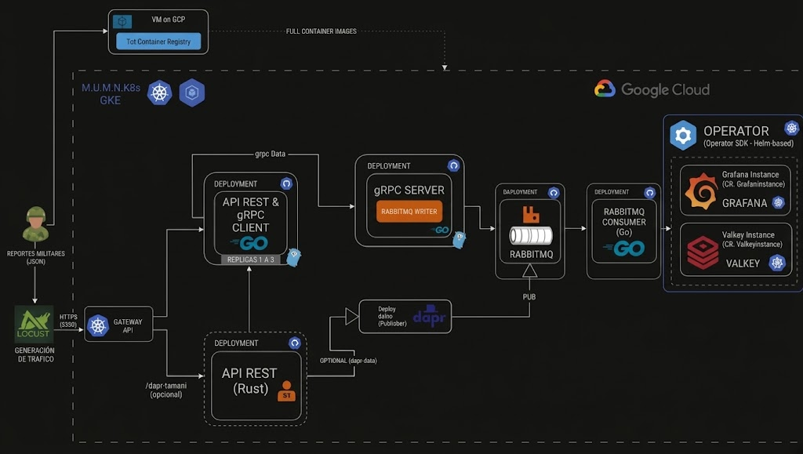
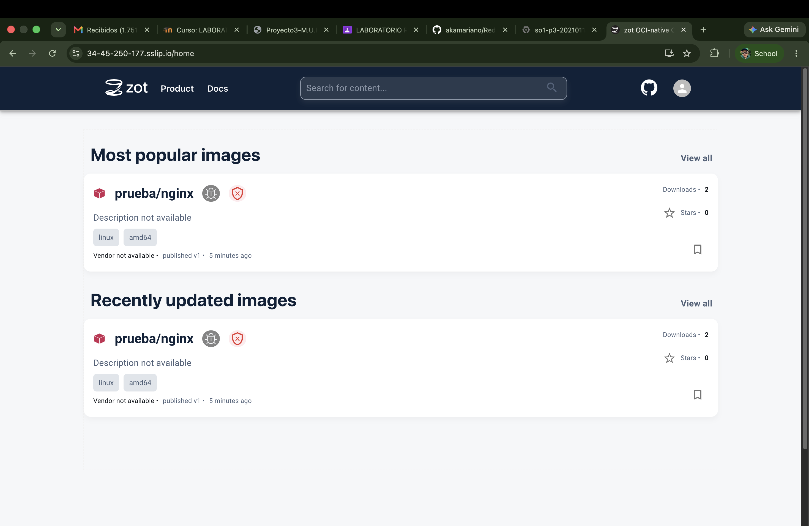

# Manual Técnico. Proyecto 3, Sistemas Operativos 1
## M.U.M.N.K8s: Monitoreo de Unidades Militares en la Nube con Kubernetes

| Campo | Valor |
|---|---|
| Nombre | Mariano Rac |
| Carné | 202101149 |
| País asignado | GTM (último dígito del carné: 9) |
| Ruta principal | `/grpc-202101149` |
| Ruta alterna (opcional) | `/dapr-202101149` |

> Estado del documento: **en construcción**. Cada sección se completa al cerrar su bloque de trabajo. La guía para levantar el entorno está en [GuiaDeInstalacion.md](GuiaDeInstalacion.md).

---

## Índice
1. [Objetivo del proyecto](#1-objetivo-del-proyecto)
2. [Arquitectura general](#2-arquitectura-general)
3. [Conceptos clave](#3-conceptos-clave)
4. [Infraestructura en GCP](#4-infraestructura-en-gcp)
5. [Zot: registry de imágenes](#5-zot-registry-de-imágenes)
6. [Flujo completo de datos](#6-flujo-completo-de-datos)
7. [Kubernetes Gateway API](#7-kubernetes-gateway-api)
8. [Comunicación REST y gRPC](#8-comunicación-rest-y-grpc)
9. [RabbitMQ](#9-rabbitmq)
10. [Operator: Valkey y Grafana](#10-operator-valkey-y-grafana)
11. [HPA](#11-hpa)
12. [OCI Artifact](#12-oci-artifact)
13. [Dashboard de Grafana](#13-dashboard-de-grafana)
14. [Pruebas de carga y análisis de réplicas](#14-pruebas-de-carga-y-análisis-de-réplicas)
15. [Extras: Dapr y Falco](#15-extras-dapr-y-falco)
16. [Problemas encontrados y soluciones](#16-problemas-encontrados-y-soluciones)
17. [Conclusiones](#17-conclusiones)

---

## 1. Objetivo del proyecto

Construir en Google Cloud Platform un sistema distribuido y escalable que recibe en tiempo real reportes militares simulados. Cada reporte indica un país, los aviones de guerra en el aire, los barcos de guerra en el mar y una marca de tiempo. El sistema los procesa, los encola, los almacena y los muestra en un dashboard.

El proyecto demuestra el uso de:
- contenedores y orquestación con **GKE**;
- microservicios en **Rust** y **Go**, comunicados por **REST** y **gRPC**;
- mensajería asíncrona con **RabbitMQ**;
- extensión de Kubernetes con un **Operator** (Operator SDK, basado en Helm) que administra **Valkey** y **Grafana** como Custom Resources;
- un registry privado (**Zot**) en una VM fuera del clúster;
- pruebas de carga con **Locust** y autoescalado con **HPA**.

Ejemplo de mensaje:

```json
{
  "country": "GTM",
  "warplanes_in_air": 42,
  "warships_in_water": 14,
  "timestamp": "2026-03-12T20:15:30Z"
}
```

## 2. Arquitectura general



```
Locust ──HTTPS──▶ Gateway API ──/grpc-202101149──▶ API REST (Rust, HPA 1-3)
                                                        │ HTTP
                                                        ▼
                                          Go Deployment 1 (REST + cliente gRPC)
                                                        │ gRPC
                                                        ▼
                                          Go Deployment 2 (servidor gRPC + writer)
                                                        │ AMQP publish
                                                        ▼
                                                    RabbitMQ
                                                        │ AMQP consume
                                                        ▼
                                              Consumer (Go) ──▶ Valkey (CR ValkeyInstance)
                                                                     │
                                                                     ▼
                                                           Grafana (CR GrafanaInstance)

  Zot (VM en GCP, fuera del clúster) ──imágenes por HTTPS──▶ todos los Deployments
```

| Componente | Tecnología | Dónde corre | Estado |
|---|---|---|---|
| Generador de carga | Locust | Máquina local | Pendiente |
| Exposición | Kubernetes Gateway API (GKE) | GKE | Habilitado (bloque 1) |
| API REST | Rust | GKE | Pendiente |
| Deployment 1 | Go: REST + cliente gRPC | GKE | Pendiente |
| Deployment 2 | Go: servidor gRPC + writer de RabbitMQ | GKE | Pendiente |
| Broker | RabbitMQ | GKE | Pendiente |
| Consumer | Go | GKE | Pendiente |
| Almacenamiento | Valkey, administrado por el Operator | GKE | Pendiente |
| Visualización | Grafana, administrado por el Operator | GKE | Pendiente |
| Registry | Zot v2.1.22 | VM `zot-vm` | **Funcionando** |

## 3. Conceptos clave

| Concepto | Qué es | Para qué se usa en el proyecto |
|---|---|---|
| **Contenedor / imagen OCI** | Un paquete con una aplicación y sus dependencias. OCI es el estándar abierto del formato | Cada servicio (Rust, Go, consumer, operator) es una imagen |
| **Registry** | Un servidor que almacena imágenes, como Docker Hub | Zot guarda todas las imágenes del proyecto |
| **Kubernetes (K8s)** | Un orquestador: decide en qué nodo corre cada contenedor, los reinicia si fallan y los escala | Es la base de todo el sistema |
| **GKE** | Kubernetes administrado por Google: Google opera el *control plane* y nosotros solo los nodos | El clúster `so1-p3` |
| **Nodo** | Una VM que ejecuta pods. En GKE corre kubelet y containerd | 3 nodos `n1-standard-2` |
| **Pod / Deployment / Service** | Pod: uno o más contenedores que comparten red. Deployment: mantiene N réplicas de un pod. Service: IP y DNS estables frente a pods que cambian | Cada microservicio |
| **Gateway API** | El sucesor de Ingress para exponer servicios HTTP, con recursos `Gateway` y `HTTPRoute` | La entrada pública de Locust |
| **REST vs. gRPC** | REST: JSON sobre HTTP/1.1, fácil de leer. gRPC: Protobuf binario sobre HTTP/2, con contrato tipado (`.proto`) y más eficiente | Rust → Go por REST; Go → Go por gRPC |
| **Message broker** | Un intermediario que desacopla a quien produce mensajes de quien los consume, usando colas | RabbitMQ amortigua los picos de carga |
| **HPA** | Horizontal Pod Autoscaler: agrega o quita réplicas según el uso de CPU | API de Rust: 1 a 3 réplicas cuando la CPU pasa del 30 % |
| **CRD / Custom Resource** | Extienden la API de Kubernetes con tipos nuevos, por ejemplo `ValkeyInstance` | Valkey y Grafana se piden de forma declarativa |
| **Operator** | Un controlador que **reconcilia** el estado deseado (el CR) con el estado real del clúster | Crea, actualiza y borra Valkey y Grafana |
| **Helm chart** | Una plantilla parametrizada de manifiestos de Kubernetes | El Operator basado en Helm instala el chart con los valores del CR |
| **PVC** | PersistentVolumeClaim: una solicitud de disco persistente que sobrevive al pod | Los datos de Valkey |
| **TLS / HTTPS** | Cifrado y verificación de identidad del servidor mediante un certificado firmado por una CA | Zot usa un certificado de Let's Encrypt |

## 4. Infraestructura en GCP

| Recurso | Valor |
|---|---|
| Proyecto | `so1-p3-202101149` |
| Región / zona | `us-central1` / `us-central1-c` |
| Clúster | `so1-p3`, GKE Standard zonal, Kubernetes 1.35 |
| Nodos | 3 × `n1-standard-2` (2 vCPU, 7.5 GB), disco `pd-standard` de 50 GB |
| Gateway API | Canal `standard` (`--gateway-api standard`) |
| VM de Zot | `zot-vm`, `n1-standard-1`, Ubuntu 24.04, disco de 30 GB |
| IP estática de Zot | `34.45.250.177` |

Decisiones de diseño:
- **Clúster zonal.** La gestión de un clúster zonal entra en el nivel gratuito de GKE; uno regional triplicaría los nodos.
- **Disco `pd-standard` de 50 GB.** El disco por defecto (`pd-balanced` de 100 GB) cuenta contra la cuota de SSD de 250 GB, y con 3 nodos sumaría 300 GB.
- **Zona `us-central1-c`.** En `us-central1-a` y `us-central1-b` no había capacidad para máquinas N1 (`ZONE_RESOURCE_POOL_EXHAUSTED`).


## 5. Zot: registry de imágenes

Zot es un registry OCI ligero. Corre como contenedor dentro de la VM `zot-vm`, **fuera del clúster**, y sirve HTTPS directamente.

| Aspecto | Implementación |
|---|---|
| Dominio | `34-45-250-177.sslip.io`. sslip.io es un DNS público que resuelve el nombre a la IP incluida en él |
| Certificado | Let's Encrypt, obtenido con `certbot --standalone` mediante el reto HTTP-01 en el puerto 80 |
| Renovación | Un *deploy hook* de certbot copia el certificado nuevo a `/opt/zot/tls` y reinicia Zot |
| Puertos | 443 en la VM, que redirige al 5000 del contenedor. Regla de firewall `allow-zot` (tcp:80,443) |
| Autenticación | `htpasswd` (bcrypt), usuario `admin` |
| Control de acceso | **Lectura anónima** (GKE descarga sin `imagePullSecrets`). Subir y borrar requiere autenticación |
| Persistencia | `/opt/zot/data` en la VM |
| Interfaz web | Extensiones `search` y `ui` habilitadas |

Configuración (`/opt/zot/config.json`, generada por [zot/instalar_zot.sh](zot/instalar_zot.sh)):

```json
{
  "distSpecVersion": "1.1.1",
  "storage": { "rootDirectory": "/var/lib/registry", "gc": true },
  "http": {
    "address": "0.0.0.0", "port": "5000", "realm": "zot",
    "tls": { "cert": "/etc/zot/tls/fullchain.pem", "key": "/etc/zot/tls/privkey.pem" },
    "auth": { "htpasswd": { "path": "/etc/zot/htpasswd" } },
    "accessControl": { "repositories": { "**": {
      "anonymousPolicy": ["read"],
      "defaultPolicy": ["read", "create", "update", "delete"] } } }
  },
  "extensions": { "search": { "enable": true }, "ui": { "enable": true } }
}
```

**Arquitectura de las imágenes.** La máquina de desarrollo es una Mac con Apple Silicon (arm64) y los nodos N1 son x86_64, así que todas las imágenes se construyen para `linux/amd64`. Una imagen arm64 fallaría en GKE con `exec format error`.

Validación del ciclo de push y pull:

| Prueba | Resultado |
|---|---|
| `GET /v2/` por HTTPS | 200, con certificado emitido por Let's Encrypt |
| Push anónimo | 401, rechazado |
| `docker push .../prueba/nginx:v1` con login | Aparece en `/v2/_catalog` |
| Pod en GKE con imagen de Zot | `Successfully pulled image "34-45-250-177.sslip.io/prueba/nginx:v1"` |

Interfaz web de Zot servida por HTTPS (`https://34-45-250-177.sslip.io/home`), con la imagen de prueba `prueba/nginx:v1` publicada para `linux/amd64` y 2 descargas: el pod de prueba de GKE y la verificación.




## 6. Flujo completo de datos
_Pendiente (bloques 2 a 6)._

## 7. Kubernetes Gateway API
_Pendiente (bloque 3)._

## 8. Comunicación REST y gRPC
_Pendiente (bloque 2)._

## 9. RabbitMQ
_Pendiente (bloque 4)._

## 10. Operator: Valkey y Grafana
_Pendiente (bloques 5 y 6): CRDs, Helm charts encapsulados y lógica de reconciliación._

## 11. HPA
_Pendiente (bloque 3)._

## 12. OCI Artifact
_Pendiente (bloque 7): qué archivo JSON se publica en Zot, cómo se sube con `oras push` y cómo se consume._

## 13. Dashboard de Grafana
_Pendiente (bloque 6)._

## 14. Pruebas de carga y análisis de réplicas
_Pendiente (bloque 7): Locust; 1 vs. 2 réplicas en los Go writers y en Valkey._

## 15. Extras: Dapr y Falco
_Pendiente (bloque 8, opcional)._

## 16. Problemas encontrados y soluciones

| Problema | Causa | Solución |
|---|---|---|
| `ZONE_RESOURCE_POOL_EXHAUSTED` al crear la VM y el clúster | No había capacidad N1 en `us-central1-a` ni en `us-central1-b` | El script prueba varias zonas; todo quedó en `us-central1-c` |
| No se podía borrar el clúster atascado en `us-central1-a` | GKE no permite borrar un clúster mientras está en `CREATE_CLUSTER`, y esa operación no se puede cancelar | Se creó el clúster en otra zona (el nombre es único por zona) y el viejo se borra cuando termina la operación |
| `Compute Engine API has not been used` | Las APIs vienen deshabilitadas en un proyecto nuevo | `gcloud services enable compute.googleapis.com container.googleapis.com` |
| El formula `rustup` de Homebrew no trae `rustup-init` | Cambio de empaquetado (keg-only) | Se usa `$(brew --prefix rustup)/bin/rustup default stable` |

## 17. Conclusiones
_Pendiente._
